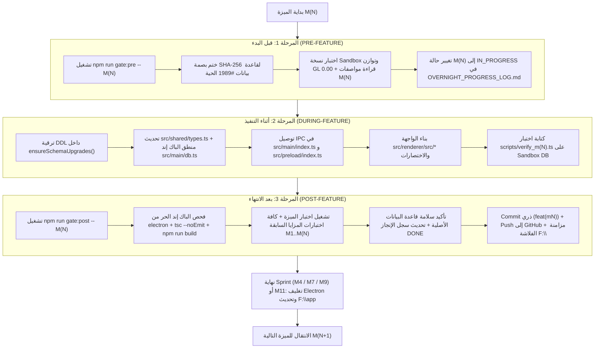

# البروتوكول الثابت لتنفيذ المزايا الـ 11 (Pre / During / Post Feature Workflow)

> **الهدف:** ضمان تنفيذ كل وحدة من الوحدات الـ **11** الموثقة في [`TITAN_11_MODULES_MASTER_PLAN.md`](file:///d:/pharmacy/titan_modern_pos/TITAN_11_MODULES_MASTER_PLAN.md) منفردة وبانضباط هندسي كامل دون أي مساس بقاعدة البيانات الإنتاجية لصيدلية `#1989` ([`pharmacy.sqlite`](file:///d:/pharmacy/titan_modern_pos/data/pharmacy.sqlite))، مع تحقق آلي تراكمي يمنع حدوث أي تراجع (Regression) في المزايا السابقة.

---

## 1. دورة العمل الثابتة لكل ميزة (`M1` ← `M11`)



---

## 2. تفاصيل المراحل الثلاث والأوامر الإلزامية

### المرحلة الأولى: قبل البدء (`PRE-FEATURE`)
1. تشغيل البوابة التحضيرية:
   ```powershell
   npm run gate:pre -- M1
   ```
   - تتأكد من نظافة `git status -- data/pharmacy.sqlite`.
   - تحفظ بصمة `SHA-256` للقاعدة الأصلية في `data/.baseline_db.sha256` (مستبعدة في `.gitignore`).
   - تنسخ القاعدة الحية إلى ملف معزول مؤقت (`m1.sandbox.sqlite`) وتفحص `checkLedgerIntegrity() === 0.00` مرتين للتأكد من قابلية إعادة التشغيل الآمن (`Idempotency`).
2. قراءة بند **`### Module N:`** بالكامل من [`TITAN_11_MODULES_MASTER_PLAN.md`](file:///d:/pharmacy/titan_modern_pos/TITAN_11_MODULES_MASTER_PLAN.md).
3. تحديث حالة الميزة إلى `🔄 IN_PROGRESS` في [`OVERNIGHT_PROGRESS_LOG.md`](file:///d:/pharmacy/titan_modern_pos/OVERNIGHT_PROGRESS_LOG.md).

---

### المرحلة الثانية: أثناء العمل (`DURING-FEATURE`)
تُنفَّذ الميزة **وحدها فقط** بالترتيب الطبقي التالي:
1. **قاعدة البيانات (`ensureSchemaUpgrades` في `src/main/db.ts`):** استخدام `CREATE TABLE IF NOT EXISTS` وفحص الأعمدة الآمن (`addColumnIfNotExists`) دون حذف أو تعديل بيانات `#1989` الحية يدوياً.
2. **العقود والأنواع (`src/shared/types.ts`):** تعريف واجهات TypeScript والدوال الحسابية النقية المشتركة.
3. **الباك إند (`src/main/db.ts`):**
   - **منع استيراد `electron` تماماً** في `db.ts` و`src/shared/*` للحفاظ على عمل سكربتات الترحيل مثل [`run_t0_cutover.ps1`](file:///f:/Migration_Scripts/run_t0_cutover.ps1).
   - تغليف كل عمليات الكتابة المالية داخل `database.transaction(...)` وتحقيق اتزان القيد المزدوج `0.00 EGP` في `general_ledger_2026`.
   - تجميع أرصدة الموردين عبر `account_name LIKE 'خصوم.متداولة.موردين%'` لشمول حساب `'خصوم.متداولة.موردين.الكل'` التاريخي.
4. **الجسر والتطبيق (`src/main/index.ts` + `src/preload/index.ts`):** تعريف قنوات `ipcMain.handle` وربطها في `contextBridge`.
5. **الواجهة (`src/renderer/src/`):** تنفيذ الشاشات والاختصارات مع حماية الصلاحيات (`CASHIER` / `PHARMACIST` / `ADMIN`).
6. **اختبار الميزة المعزول (`scripts/verify_m<N>.ts`):** استخدام الدالة [`withSandboxDb`](file:///d:/pharmacy/titan_modern_pos/scripts/lib/sandbox_db.ts) التي تنسخ القاعدة، وتختبر كل بنود `(هـ)` الخاصة بالميزة، وتفحص توازن GL وإعادة الترقية مرتين، ثم تحذف ملفات Sandbox.

---

### المرحلة الثالثة: بعد الانتهاء (`POST-FEATURE`)
1. تشغيل بوابة الاعتماد التلقائية:
   ```powershell
   npm run gate:post -- M1
   ```
   التي تفرض آلياً وبصرامة نجاح جميع الفحوصات التالية (وأي فشل يوقف الانتقال حتى يُصلَح):
   - **Check 1:** تطابق بصمة `SHA-256` لقاعدة [`pharmacy.sqlite`](file:///d:/pharmacy/titan_modern_pos/data/pharmacy.sqlite) الحية مع البصمة الموثقة وخلو `git status` عليها.
   - **Check 2:** خلو `src/main/db.ts` و`src/shared/*` من أي استيراد لـ `electron`.
   - **Check 3:** نجاح `npx tsc --noEmit` بدون أي خطأ TypeScript.
   - **Check 4:** نجاح `npm run build` (`build:electron` + `vite build`).
   - **Check 5:** تشغيل `scripts/verify_m<N>.ts` **بالإضافة لكل اختبارات المزايا السابقة `verify_m1..m<N-1>.ts`** (اختبار عدم التراجع التراكمي).
   - **Check 6:** تنظيف أي مخلفات `*.sandbox.sqlite*` وتأكيد بقاء القاعدة الأصلية سليمة 100%.
2. تحديث صف الميزة في [`OVERNIGHT_PROGRESS_LOG.md`](file:///d:/pharmacy/titan_modern_pos/OVERNIGHT_PROGRESS_LOG.md) إلى `✅ DONE` وإضافة سطر في السجل الزمني.
3. عمل Commit ذري نظيف (`feat(m<N>): ...`) مع التحقق من عدم ضم `data/pharmacy.sqlite`، ثم `git push origin main`.
4. إذا كانت الفلاشة `F:\` متصلة:
   - مزامنة الكود إلى `F:\Source_Code` عبر `robocopy`.
   - نسخ `OVERNIGHT_PROGRESS_LOG.md` إلى `F:\OVERNIGHT_PROGRESS_LOG.md`.
5. **نقاط التغليف (`Sprint Checkpoints`):**
   - بعد إتمام كل Sprint (`M4`، `M7`، `M9`): تشغيل `npm run package:dir` ومزامنة `release\win-unpacked` ← `F:\app`.
   - بعد إتمام **`M11`**: التغليف النهائي (`npx electron-builder --win dir portable nsis`) وتحديث ملفات التثبيت والتشغيل المباشر على الفلاشة `F:\`.

---

## 3. حواجز الأمان الصارمة (`Guardrails`)
- ممنوع تماماً تعديل [`pharmacy.sqlite`](file:///d:/pharmacy/titan_modern_pos/data/pharmacy.sqlite) مباشرة أثناء التطوير أو الاختبار.
- ممنوع تخطي أي فحص في `gate:post` أو إرخاء شروط `assert` في الاختبارات.
- ممنوع دمج أكثر من ميزة في Commit واحد.
- ممنوع المساس بمجلدات الفلاشة الحيوية (`F:\Migration_Scripts`، `F:\Antigravity_Setup`، `F:\Titandata`، `F:\Titan.guide`).

---

## 4. ملفات منظومة العمل المنشأة
- قواعد التشغيل الدائمة: [`AGENTS.md`](file:///d:/pharmacy/titan_modern_pos/AGENTS.md)
- المهارة التنفيذية: [`SKILL.md`](file:///d:/pharmacy/titan_modern_pos/.agents/skills/titan-feature-workflow/SKILL.md)
- أداة البوابات الآلية: [`feature_gate.ts`](file:///d:/pharmacy/titan_modern_pos/scripts/feature_gate.ts) و [`sandbox_db.ts`](file:///d:/pharmacy/titan_modern_pos/scripts/lib/sandbox_db.ts)
- سجل التقدم الحي: [`OVERNIGHT_PROGRESS_LOG.md`](file:///d:/pharmacy/titan_modern_pos/OVERNIGHT_PROGRESS_LOG.md)
