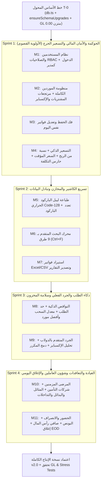

# الخطة التنفيذية الشاملة لاستكمال منظومة تيتان الحديثة (Titan Modern POS — 11 Modules Master Plan)

> **الغرض من الوثيقة:** خريطة هندسية وتنفيذية كاملة لسد الفجوات الـ 11 المكتشفة عند مراجعة النظام القديم (**Titan 3 / `Phye.exe`** وملف المساعدة **`LocalHelp.phy`** ونسخ **`Titandata`** الحية لصيدلية `#1989`) مقارنة بالإصدار الحديث **`titan_modern_pos`**.  
> **نطاق هذه الوثيقة:** تصميم وتوثيق معماري وقاعدة بيانات وواجهات واختبارات تحقق لـ **4 سبرينتات (Sprints)** متدرجة دون كسر التوافق مع `run_t0_cutover.ps1` أو توازن قيود الأستاذ العام (`0.00 EGP`).

---

## 1. النظرة المعمارية العامة والتوافق مع الترحيل الصفري (Zero-Downtime & GL Invariants)

### 1.1 خط الأساس التشغيلي الموثق (Baseline DB — صيدلية `#1989`)
تعتمد هذه الخطة على الفحص المباشر لقاعدة البيانات الحية [`pharmacy.sqlite`](file:///d:/pharmacy/titan_modern_pos/data/pharmacy.sqlite) وسجلات التشغيل الفعلية للنظام القديم:
- **الأصناف والمخزون:** `18,704` صنف إجمالاً، منها `2,122` صنف برصيد فعلي (`current_stock > 0`)، و`5,053` صنف تم ضبط `package_units > 1` لها (شرائط/وحدات فرعية).
- **الفواتير والخزينة:** `#468` فاتورة مشتريات، ورصيد الخزينة `276,666.50 EGP` (بتاريخ `2026-11-17 23:38:48`).
- **الأستاذ العام (`general_ledger_2026`):** `185` قيداً متزناً بالكامل (`Debit = Credit = 383,620.50 EGP`) عبر الحسابات التالية:
  - `'اصول.متداولة.مخزون'`: مدين `156,508.60` | دائن `95,856.20` (57 قيداً)
  - `'اصول.متداولة.نقدية.كاش'`: مدين `131,070.40` | دائن `144,652.80` (57 قيداً)
  - `'ايرادات.مبيعات'`: مدين `0.00` | دائن `131,070.40` (30 قيداً)
  - `'خصوم.متداولة.موردين.الكل'`: مدين `185.30` | دائن `12,041.10` (11 قيداً)
  - `'مصروفات.تشغيلية.تكلفة مبيعات'`: مدين `95,856.20` | دائن `0.00` (30 قيداً)
- **الموردون الحاليون (`suppliers`):** 18 مورداً (`1..18`) تشمل حسابات النظام الداخلي (`1: الشراء من غير الموردين`، `2: جرد اولي`، `3: ادوية معدومة`) والمخازن والشركات (`4: المتحدة للصيادلة`، `5: المصرية لتجارة الادوية`، `6: ابن سينا`، `7: فارما اوفر سيز`، وحتى `18: دوائي`).
- **شواهد الاستخدام الفعلي من ملفات Legacy:**
  - ملف `login-h.phy` يثبت أن الصيدلية تسجل الدخول فعلياً بحساب **`شروق`** و**`مدير الصيدلية`**.
  - ملف `LastEdited.phy` يحتوي على `6,628` بلوكاً غير صفري تسجل **`سعر مؤقت`** و**`البونص`** و**`سعر العبوة`**.
  - بينما ملفات مثل `DealsInfo.phy` و`masrofat.phy` و`delivery.phy` و`integrations.phy` كانت بحجم `0 B` (ميزات غير مفعلة ميدانياً في تلك النسخة).

### 1.2 نقاط حرجة يجب معالجتها فور البدء (Pre-Sprint Schema & GL Reconciliation)
1. **تنظيف وإعادة تأهيل جدول `users` في `ensureSchemaUpgrades()`:**
   - الوضع الحالي في القاعدة المحولة:
     - الصفوف `1..4`: `('مندوب الدعم الفني \x0f', 8224, 8224)`، `('مدير الصيدلية \x0f', 8224, 8224)`، `('شروق \x0f', 8224, 8224)`، `('اسراء \x0f', 8224, 8224)` — تحمل بايت التحكم `\x0f` وقيمة `is_active = 8224` (بدلاً من `1`).
     - الصفوف `5..98`: خانات فارغة باسم `'\x0f'` وقيم `8224`.
     - الصف `99`: `('د. مريم الحميلي', 1, 8224)` — الوحيد النشط حالياً (`is_active = 1`).
   - **قاعدة الهجرة التلقائية (Idempotent Cleanup):** عند ترقية القاعدة داخل `ensureSchemaUpgrades()`، يتم تنظيف `\x0f` بـ `TRIM(REPLACE(user_name, char(15), ''))`، وحذف الخانات الفارغة (`5..98` التي اسمها فارغ بعد التنظيف)، وتفعيل المستخدمين الحقيقيين (`2: مدير الصيدلية`, `3: شروق`, `4: اسراء`, `99: د. مريم الحميلي`) برموز PIN مبدئية وأدوار واضحة (`ADMIN` / `PHARMACIST` / `CASHIER`).
2. **توحيد حساب الموردين في تقارير الأستاذ العام:**
   - القيود التاريخية المحولة من النظام القديم تستخدم `'خصوم.متداولة.موردين.الكل'`، بينما الدوال الحديثة في `src/main/db.ts` قد تسجل تحت `'خصوم.متداولة.موردين'`.
   - **الإلزام المعماري:** جميع استعلامات أرصدة الموردين ورأس المال الصافي في `db.ts` يجب أن تجمع باستخدام `account_name LIKE 'خصوم.متداولة.موردين%'` لضمان عدم سقوط الـ `11,855.80 EGP` صافي رصيد الموردين التاريخي من الميزانية.
3. **قاعدة الحفاظ على معمارية التشغيل:**
   - يظل [`db.ts`](file:///d:/pharmacy/titan_modern_pos/src/main/db.ts) خالياً تماماً من استيراد `electron` ليعمل مع سكربتات Node مثل [`run_t0_cutover.ps1`](file:///F:/Migration_Scripts/run_t0_cutover.ps1).
   - استمرار تشغيل `ensureSchemaUpgrades()` داخل `initDatabase()` وتمرير `checkLedgerIntegrity()` (`SUM(debit) - SUM(credit) == 0.00`) بعد كل عملية مالية أو ترحيل.

### 1.3 خريطة السبرينتات الأربعة (4-Sprint Roadmap)



---

## 2. Sprint 1 — الحوكمة، الموردون، تعديل الفواتير، والتسعير الحرج (Modules 1–4)

---

### Module 1: نظام المستخدمين والصلاحيات والدخول السريع (`RBAC Login & Manager Elevation`)

#### (أ) سير العمل التشغيلي وقواعد العمل
- لا يفتح النظام مباشرة على بيانات الخزينة أو الأرباح، بل يعرض شاشة قفل/دخول سريعة بالباركود أو اختيار المستخدم + PIN (4–6 أرقام).
- المستويات المعيارية المستمدة من Titan 3 و`login-h.phy`:
  - **`ADMIN` (مدير الصيدلية / د. مريم الحميلي):** صلاحية كاملة شاملة الخزينة، التكلفة، الربحية، التعديل تحت التكلفة، إدارة المستخدمين، والإغلاق اليومي.
  - **`PHARMACIST` (صيدلي مسؤول — مثل `شروق`):** البيع، المرتجع اليومي، المشتريات، النواقص، دون حذف فواتير أيام سابقة أو تغيير إعدادات رأس المال أو تعديل الصلاحيات.
  - **`CASHIER` (كاشير — مثل `اسراء`):** نقطة البيع `F1` وفواتير اليوم `F12` وطلبات النواقص، مع إخفاء أرقام الخزينة (`الخزينة` في `Header.tsx`)، إخفاء سعر الشراء/التكلفة والهامش، ومنع الخصم الحر.
- **قاعدة "الدخول كمدير" (Temporary Manager Override من `LocalHelp.phy`):**
  - عند محاولة الكاشير تنفيذ عملية محجوبة أثناء بيع فعلي (مثلاً: خصم يتجاوز الحد، البيع بسعر أقل من التكلفة، فك حفظ فاتورة، أو مرتجع بدون فاتورة)، لا يتم تسجيل خروجه ولا تضيع السلة المفتوحة في الكاشير؛ بل يظهر `ManagerOverrideModal` يطلب PIN المدير لتفويض العملية **الواحدة فقط** ويسجلها باسم الكاشير + اسم المدير المفوض في `login_audit_log`.

#### (ب) تعديلات قاعدة البيانات (`SQLite DDL` داخل `ensureSchemaUpgrades()`)
```sql
-- 1) إضافة أعمدة الصلاحيات والأمان لجدول users القائم
ALTER TABLE users ADD COLUMN pin_code TEXT DEFAULT '';
ALTER TABLE users ADD COLUMN role TEXT DEFAULT 'CASHIER'; -- 'ADMIN' | 'PHARMACIST' | 'CASHIER'
ALTER TABLE users ADD COLUMN allowed_tabs TEXT DEFAULT '["pos","shortages","invoices"]';
ALTER TABLE users ADD COLUMN badge_barcode TEXT DEFAULT '';
ALTER TABLE users ADD COLUMN max_discount_pct REAL DEFAULT 0;
ALTER TABLE users ADD COLUMN commission_pct REAL DEFAULT 0;

-- 2) سجل الدخول والتفويضات الإدارية
CREATE TABLE IF NOT EXISTS login_audit_log (
  id INTEGER PRIMARY KEY AUTOINCREMENT,
  user_id INTEGER NOT NULL,
  user_name TEXT NOT NULL,
  action_type TEXT NOT NULL, -- 'LOGIN' | 'LOGOUT' | 'SWITCH_USER' | 'MANAGER_OVERRIDE' | 'FAILED_PIN'
  authorized_by_id INTEGER DEFAULT NULL,
  authorized_by_name TEXT DEFAULT '',
  target_ref TEXT DEFAULT '', -- مثل رقم الفاتورة أو سبب التفويض
  created_at TEXT NOT NULL
);

-- 3) تنظيف بيانات users المحولة من Titan 3 (مرة واحدة / Idempotent)
UPDATE users SET user_name = TRIM(REPLACE(user_name, char(15), ''));
DELETE FROM users WHERE user_id BETWEEN 5 AND 98 AND (user_name = '' OR user_name IS NULL);
UPDATE users SET is_active = 1, role = 'ADMIN', pin_code = '1989',
  allowed_tabs = '["pos","purchases","shortages","treasury","inventory","reports","invoices","settings"]',
  max_discount_pct = 100
  WHERE user_id IN (2, 99) AND (pin_code IS NULL OR pin_code = '');
UPDATE users SET is_active = 1, role = 'PHARMACIST', pin_code = '1111',
  allowed_tabs = '["pos","purchases","shortages","inventory","invoices"]',
  max_discount_pct = 10
  WHERE user_id = 3 AND (pin_code IS NULL OR pin_code = '');
UPDATE users SET is_active = 1, role = 'CASHIER', pin_code = '2222',
  allowed_tabs = '["pos","shortages","invoices"]',
  max_discount_pct = 3
  WHERE user_id = 4 AND (pin_code IS NULL OR pin_code = '');
UPDATE users SET is_active = 0, role = 'SUPPORT' WHERE user_id = 1;
```

#### (ج) دوال الباك إند، عقود IPC، وقيود الأستاذ العام
- **في `src/shared/types.ts`:** تعريف `UserRole`, `UserAccount`, `AuthSession`, `ManagerOverridePayload`.
- **في `src/main/db.ts`:**
  - `listActiveUsers(): UserAccount[]` (يرجع المستخدمين النشطين دون كشف `pin_code` للواجهة).
  - `authenticateUser(userIdOrBarcode: string | number, pinCode: string): AuthSession` (تخزين PIN محلياً بصيغة hashed SHA-256 + salt ثابت للقاعدة أو مقارنة متوافقة عند أول تفعيل مع الترقية التلقائية للهجرة، وتسجيل في `login_audit_log`).
  - `verifyManagerOverride(pinCode: string, currentUserId: number, actionLabel: string, targetRef?: string): { ok: boolean; managerId?: number; managerName?: string }`.
  - `upsertUser(payload)` و `toggleUserActive(userId)` (تتطلب جلسة `ADMIN`).
- **Preload / `src/main/index.ts`:** قنوات `auth:list-users`, `auth:login`, `auth:override-manager`, `auth:upsert-user`, `auth:get-audit-log`.
- **الأستاذ العام:** لا توجد قيود مالية مباشرة؛ لكن حقول `user_id` و `cashier_name` تُربط بكل فاتورة بيع/مرتجع/حركة خزينة في الجداول المالية.

#### (د) مكونات الواجهة والاختصارات (`React UI`)
- **`AuthContext` + `LoginScreen.tsx`:** شاشة دخول سريعة تدعم اختيار الاسم بلمسة واحدة أو مسح باركود الكارنيه + إدخال PIN، وزر تبديل مستخدم سريع في [`Header.tsx`](file:///d:/pharmacy/titan_modern_pos/src/renderer/src/components/Header.tsx).
- **`ManagerOverrideModal.tsx`:** نافذة منبثقة احترافية تظهر فور أي عملية محظورة دون مسح سلة المبيعات.
- **حماية العرض حسب الدور:**
  - إخفاء بطاقة `الخزينة` من [`Header.tsx`](file:///d:/pharmacy/titan_modern_pos/src/renderer/src/components/Header.tsx) إذا كان `role === 'CASHIER'`.
  - إخفاء تبويبات `F5` (الخزينة) و`F6` (التقارير المالية) و`إدارة المستخدمين` عن الكاشير في [`App.tsx`](file:///d:/pharmacy/titan_modern_pos/src/renderer/src/App.tsx).
  - إخفاء أعمدة `buy_price` و`الربح` من `PosView` و`SalesInvoicesView` و`CatalogInventoryView` لغير `ADMIN`.
- **الاختصارات:** `Ctrl+L` قفل الشاشة وتبديل المستخدم فوراً.

#### (هـ) اختبارات التحقق (`Verification`)
1. تشغيل `ensureSchemaUpgrades()` على نسخة من القاعدة الحية والتأكد أن `\x0f` اختفى، الصفوف الفارغة `5..98` حُذفت، وأن `مدير الصيدلية` و`شروق` و`اسراء` و`د. مريم الحميلي` فعالون.
2. الدخول بحساب `اسراء` (`CASHIER`): التأكد من اختفاء رصيد الخزينة `276,666.50` وتبويب `F5` و`F6`، وبقاء شاشة `F1` مفتوحة عند طلب تفويض المدير `1989` لعملية محظورة وتسجيل `MANAGER_OVERRIDE` في `login_audit_log`.

---

### Module 2: منظومة الموردين الكاملة، كشف الحساب، ومرتجعات المشتريات والإكسباير (`Full Supplier & Purchase Returns System`)

#### (أ) سير العمل التشغيلي وقواعد العمل
- سد الفجوة الكبيرة في شاشة `PurchasesView` (`F3`): حالياً تدعم الشراء فقط (`نقدي` أو `آجل`) ولا تدعم سداد دفعات للمورد، ولا عرض كشف الحساب التفصيلي، ولا عمل **مرتجع مشتريات** أو **مرتجع منتهي الصلاحية (Expiry Return)** للمخزن.
- **ثلاث عمليات مالية متكاملة على حساب المورد:**
  1. **سداد دفعة لمورد (`SUPPLIER_PAYMENT`):** خصم من الخزينة (`cash_balance`) أو تحويل بنكي وتخفيض رصيد المورد المستحق.
  2. **مرتجع مشتريات عادي (`PURCHASE_RETURN`):** إرجاع كمية للمخزن (بناءً على رقم فاتورة شراء سابقة أو مباشر) -> يخصم الكمية من `items.current_stock`، ويسجل قيمة المرتجع حسب التسوية:
     - إما خصم من حساب المورد الآجل (`CREDIT_NOTE` — الأكثر شيوعاً في المخازن)، أو استرداد نقدي فوري للخزينة (`CASH_REFUND`).
  3. **مرتجع منتهي الصلاحية (`EXPIRY_RETURN`):** إرجاع أدوية منتهية أو قريبة الانتهاء للمورد سواء بـ 100% من قيمتها أو بنسبة تعويض متفق عليها (مثلاً `compensate_pct` من 0% إلى 100%؛ والفرق يُحمّل تلقائياً على حساب `'مصروفات.تشغيلية.هوالك واكسباير'` للحفاظ على اتزان المخزون 100%).

#### (ب) تعديلات قاعدة البيانات (`SQLite DDL`)
```sql
ALTER TABLE suppliers ADD COLUMN tax_id TEXT DEFAULT '';
ALTER TABLE suppliers ADD COLUMN address TEXT DEFAULT '';
ALTER TABLE suppliers ADD COLUMN credit_limit REAL DEFAULT 0;
ALTER TABLE suppliers ADD COLUMN opening_balance REAL DEFAULT 0; -- رصيد أول المدة المحول

CREATE TABLE IF NOT EXISTS purchase_returns (
  return_id INTEGER PRIMARY KEY AUTOINCREMENT,
  supplier_id INTEGER NOT NULL,
  supplier_name TEXT NOT NULL,
  original_purchase_id INTEGER DEFAULT 0,
  return_type TEXT NOT NULL, -- 'PURCHASE_RETURN' | 'EXPIRY_RETURN'
  settlement_mode TEXT NOT NULL, -- 'SUPPLIER_CREDIT' | 'CASH_REFUND'
  total_cost_value REAL NOT NULL, -- قيمة المخزون الخارج بسعر التكلفة
  credit_amount REAL NOT NULL, -- القيمة التي وافق المورد على خصمها أو سدادها
  expiry_loss_amount REAL DEFAULT 0, -- الفرق إن وجد في حالة خصم إكسباير غير كامل
  user_id INTEGER DEFAULT 0,
  cashier_name TEXT DEFAULT '',
  notes TEXT DEFAULT '',
  return_date TEXT NOT NULL,
  FOREIGN KEY(supplier_id) REFERENCES suppliers(supplier_id)
);

CREATE TABLE IF NOT EXISTS purchase_return_items (
  id INTEGER PRIMARY KEY AUTOINCREMENT,
  return_id INTEGER NOT NULL,
  item_id INTEGER NOT NULL,
  item_name TEXT NOT NULL,
  quantity REAL NOT NULL,
  unit_cost REAL NOT NULL,
  line_total REAL NOT NULL,
  expiry_date TEXT DEFAULT '',
  FOREIGN KEY(return_id) REFERENCES purchase_returns(return_id),
  FOREIGN KEY(item_id) REFERENCES items(item_id)
);
```
> **ملاحظة رصيد الـ 18 مورداً القائمين:** يجب توفير دالة هجرة تتحقق من `supplier_transactions` + `general_ledger_2026 WHERE account_name LIKE 'خصوم.متداولة.موردين%'` لعرض الرصيد الفعلي لكل مورد فور التشغيل دون فقدان المديونيات السابقة.

#### (ج) دوال الباك إند، عقود IPC، وقيود الأستاذ العام (`GL Double-Entry`)
- **في `src/main/db.ts`:**
  - `getSupplierStatement(supplierId: number, fromDate?: string, toDate?: string)` -> يرجع فواتير الشراء + السدادات + المرتجعات مرتبة زمنياً مع `running_balance` ورصيد حالي موحد.
  - `recordSupplierPayment(payload: { supplierId; amount; paymentMethod; notes; userId; userName })`
    - **قيد GL:**
      - مدين: `'خصوم.متداولة.موردين'` (`amount`)
      - دائن: `'اصول.متداولة.نقدية.كاش'` (`amount`) + خصم من جدول الخزينة (وربطها بالشفت المفتوح إن وجد).
  - `createPurchaseReturn(payload: CreatePurchaseReturnPayload)` (تعمل داخل `db.transaction`):
    - تتحقق من كفاية `items.current_stock >= quantity` لكل صنف.
    - تخصم المخزون وتضيف سجل `purchase_returns` + `purchase_return_items` + `supplier_transactions` (`'مرتجع مشتريات'` أو `'مرتجع اكسباير'`).
    - **قيد GL المتزن (0.00 فرق):**
      - في حالة `SUPPLIER_CREDIT` وتعويض كامل (`expiry_loss_amount = 0`):
        - مدين: `'خصوم.متداولة.موردين'` (`credit_amount`)
        - دائن: `'اصول.متداولة.مخزون'` (`total_cost_value`)
      - في حالة `CASH_REFUND`:
        - مدين: `'اصول.متداولة.نقدية.كاش'` (`credit_amount`) (+ إضافة للخزينة)
        - دائن: `'اصول.متداولة.مخزون'` (`total_cost_value`)
      - في حالة وجود `expiry_loss_amount > 0` (`total_cost_value = credit_amount + expiry_loss_amount`):
        - يضاف سطر مدين: `'مصروفات.تشغيلية.هوالك واكسباير'` (`expiry_loss_amount`) فتكون المعادلة دائماً `Debit = Credit`.
- **IPC Channels:** `suppliers:statement`, `suppliers:record-payment`, `suppliers:create-return`, `suppliers:list-returns`, `suppliers:upsert`.

#### (د) مكونات الواجهة والاختصارات (`React UI`)
- تطوير `PurchasesView` (`F3`) لتحتوي على **4 تبويبات فرعية واضحة**:
  1. `فاتورة شراء جديدة` (الحالية + تحسينات Sprint 2).
  2. `كشف حساب مورد وسداد` (`SupplierStatementTab.tsx`): قائمة الـ 18+ مورداً برصيد كل منهم، كشف حركة مفصل، وزر **"سداد دفعة نقدية للمورد"** + طباعة كشف الحساب.
  3. `مرتجع مشتريات / إكسباير` (`PurchaseReturnTab.tsx`): سحب فاتورة شراء سابقة أو اختيار أصناف مباشرة، تحديد نوع المرتجع (عادي / منتهي صلاحية) ونسبة التسوية.
  4. `سجل الموردين وإدارتهم`: إضافة مورد جديد، تعديل الهاتف، الحد الائتماني، والبحث السريع.

#### (هـ) اختبارات التحقق (`Verification`)
1. اختبار سداد `1,000 EGP` لمورد مثل `المتحدة للصيادلة` والتأكد من نقص الخزينة بمقدار `1,000` ونقص مديونية المورد بنفس الرقم وتمرير `checkLedgerIntegrity() === 0.00`.
2. اختبار مرتجع إكسباير تكلفته `500 EGP` بنسبة تعويض `80%` (`400 EGP` خصم مورد + `100 EGP` خسائر إكسباير) والتأكد من نقص المخزون وتوازن `general_ledger_2026` عند `0.00`.

---

### Module 3: فك الحفظ وتعديل فواتير البيع في نفس اليوم (`Same-Day Unsave & Edit Invoice`)

#### (أ) سير العمل التشغيلي وقواعد العمل (مطابق حرفياً لـ `LocalHelp.phy`)
- في شاشة الكاشير وسجل الفواتير (`F12` — [`SalesInvoicesView.tsx`](file:///d:/pharmacy/titan_modern_pos/src/renderer/src/views/SalesInvoicesView.tsx))، كثيراً ما يخطئ الصيدلي في شريط زائد أو نوع دفع (كاش بدلاً من فيزا) ويريد تعديل **نفس الفاتورة `#N`** بدلاً من عمل مرتجع وفاتورة جديدة برقم جديد.
- **قواعد الأمان الصارمة من Titan 3 (`LocalHelp.phy`):**
  1. **نفس اليوم فقط:** يُسمح بتعديل الفاتورة فقط إذا كان تاريخ الفاتورة يطابق يوم التشغيل الحالي (وألا يكون تم إغلاق اليوم `EOD`). تعديل يوم سابق محجوب أو يوجَّه للمرتجع المالي.
  2. **نفس المستخدم أو تفويض المدير:** الكاشير يعدل فواتيره هو فقط في نفس اليوم؛ تعديل فاتورة موظف آخر يتطلب موافقة `ManagerOverrideModal`.
  3. **حارس كفاية النقدية في الدرج (Drawer Cash Check):** قبل فك حفظ فاتورة نقدية بقيمة `X EGP`، يتحقق الباك إند من أن `cash_balance >= X`؛ إذا كانت الخزينة لا تكفي، يوقف العملية فوراً برسالة صريحة كما في Titan: *"لا توجد نقدية كافية في الخزينة لتغطية قيمة الفاتورة المراد تعديلها"*.
  4. **الاحتفاظ بنفس رقم الفاتورة `#N`:** عند التعديل وإعادة الحفظ، يُحفظ التعديل على **نفس رقم الفاتورة `#N`** مع عكس أثرها القديم وتسجيل أثرها الجديد في المخزون والخزينة والأستاذ العام، وتدوين اللقطة السابقة في `invoice_revisions_log`.

#### (ب) تعديلات قاعدة البيانات (`SQLite DDL`)
```sql
ALTER TABLE sales_invoices ADD COLUMN edit_count INTEGER DEFAULT 0;
ALTER TABLE sales_invoices ADD COLUMN last_edited_at TEXT DEFAULT '';
ALTER TABLE sales_invoices ADD COLUMN last_edited_by TEXT DEFAULT '';
ALTER TABLE sales_invoices ADD COLUMN is_locked INTEGER DEFAULT 0; -- 1 بعد إغلاق EOD

CREATE TABLE IF NOT EXISTS invoice_revisions_log (
  revision_id INTEGER PRIMARY KEY AUTOINCREMENT,
  invoice_id INTEGER NOT NULL,
  revision_number INTEGER NOT NULL,
  edited_by_user_id INTEGER NOT NULL,
  edited_by_user_name TEXT NOT NULL,
  authorized_by_name TEXT DEFAULT '',
  old_total REAL NOT NULL,
  new_total REAL NOT NULL,
  old_payment_method TEXT NOT NULL,
  new_payment_method TEXT NOT NULL,
  old_snapshot_json TEXT NOT NULL, -- JSON كامل للأصناف والكميات قبل التعديل
  new_snapshot_json TEXT NOT NULL, -- JSON بعد التعديل
  reason TEXT DEFAULT '',
  created_at TEXT NOT NULL
);
```

#### (ج) دوال الباك إند، عقود IPC، وقيود الأستاذ العام
- **في `src/main/db.ts`:**
  - `checkCanEditSaleInvoice(invoiceId: number, currentUserId: number, currentUserRole: string)`: تفحص نفس اليوم، عدم إقفال EOD، ملكية المستخدم، وكفاية نقدية الخزينة.
  - `getSaleInvoiceForEdit(invoiceId: number)`: تجلب الفاتورة بأسطرها الكاملة مع تكلفة الوحدة وتفاصيل الباقات لتحميلها مباشرة داخل سلة `PosView` بوضع `"EDITING_INVOICE #N"`.
  - `updateSavedSaleInvoice(payload: UpdateSaleInvoicePayload)` (داخل `db.transaction`):
    1. تعيد كميات الأسطر القديمة لـ `items.current_stock`، وتعكس القيود المالية القديمة بقيود عكسية موثقة (`REVERSAL_EDIT #N`) وتطرح المبلغ القديم من `cash_balance` (إذا كان الدفع كاش) أو `customers.account_balance` (إذا كان آجل).
    2. تتحقق من كفاية المخزون للأسطر الجديدة، تخصم المخزون الجديد، تحدّث `sales_invoices` و`sales_invoice_items` على نفس `invoice_id = #N`، وترفع `edit_count = edit_count + 1`.
    3. تسجل قيود GL الجديدة (`SALE_REVISED #N`) وتحدث الخزينة/العميل، وتحفظ لقطة JSON قبل وبعد في `invoice_revisions_log`.
- **ملاحظة:** استخدام العكس الصريح (Reversal + Re-post) داخل `general_ledger_2026` بدلاً من حذف سطور الأستاذ العام يحافظ على **سلامة المراجعة المحاسبية (Audit Trail)** ويضمن دائماً `Debit - Credit = 0.00`.

#### (د) مكونات الواجهة والاختصارات (`React UI`)
- في [`SalesInvoicesView.tsx`](file:///d:/pharmacy/titan_modern_pos/src/renderer/src/views/SalesInvoicesView.tsx): إضافة زر بارز **"تعديل الفاتورة (نفس اليوم)"** بجانب زر المرتجع وطباعة الريسيت.
- في `PosView` (`F1`): إضافة شريط علوي تحذيري برتقالي عند وضع التعديل: **`وضع تعديل الفاتورة رقم #N — الحفظ سيحدث نفس الرقم مع حفظ سجل المراجعة`** مع زر إلغاء التعديل بدون أي أثر.
- إضافة نافذة منبثقة صغيرة في `F12` لعرض **"سجل التعديلات"** (`RevisionHistoryModal`) لأي فاتورة `edit_count > 0`.

#### (هـ) اختبارات التحقق (`Verification`)
1. بيع فاتورة `#N` بصنفين بقيمة `100 EGP` كاش -> التحقق من الخزينة والمخزون -> تعديل نفس الفاتورة `#N` لحذف صنف وتغيير الدفع إلى `آجل` -> التحقق أن رقم الفاتورة ظل `#N`، الخزينة رجعت `-100`، رصيد العميل زاد، المخزون عاد بدقة، `invoice_revisions_log` سُجّل، و`checkLedgerIntegrity() === 0.00`.
2. محاولة تعديل فاتورة بتاريخ أمس أو عندما `cash_balance < old_total` -> التأكد من الرفض الواضح بالرسالة المخصصة.

---

### Module 4: التسعير الذكي، أنواع الخصم، السعر المؤقت، وحارس التكلفة (`Smart Pricing, Profit-% Discount, Temp Price & Below-Cost Guard`)

#### (أ) سير العمل التشغيلي وقواعد العمل (من `LocalHelp.phy` + `LastEdited.phy`)
1. **أنواع الخصم الأربعة (`Discount Modes`):**
   - `AMOUNT`: مبلغ مقطوع بالجنيه على السطر أو الفاتورة.
   - `TOTAL_PCT`: خصم نسبة مئوية من السعر الإجمالي (يتطلب حارس تكلفة أو حد أقصى للخصم حسب الصلاحية).
   - `PROFIT_PCT` (**قاعدة تيتان الجوهرية**): عندما يطلب الصيدلي مثلاً خصم `50%` لعميل أو قريب، النظام القديم **لا يخصم 50% من سعر البيع** (لأن الألبان والإنسولين والمحلي هامشه 5%–20% فقط فيُباع بالخسارة!)، بل يحسب هامش ربح الصنف `(unit_sale_price - unit_cost_price) * qty` ويخصم `50%` **من الربح فقط**؛ بحيث يظل صافي البيع أعلى دائماً من التكلفة!
   - `WHOLESALE_COST` (`بيع بسعر الشراء/التكلفة`): مسموح فقط بتفويض المدير أو بصلاحية `ADMIN`.
2. **حارس البيع تحت التكلفة (`Below-Cost Guard`):**
   - قبل اعتماد أي بند في سلة `F1` يصبح صافي بيع وحدته `net_unit_price < unit_cost_price`، يتم حظر الحفظ وطلب `ManagerOverrideModal` فوراً (لصلاحيات `CASHIER`/`PHARMACIST`) مع إظهار الخسارة المتوقعة بالجنيه.
3. **السعر المؤقت / المزدوج (`Dual / Temporary Price`):**
   - يثبت فحص `LastEdited.phy` وجود `6,628` سجلاً لاستخدام **`سعر مؤقت`** في الصيدلية (عند تغير التسعيرة الجبرية ووجود علب بالسعر القديم وأخرى بالسعر الجديد).
   - نضيف في جدول `items` حقول `temp_price` و`temp_price_qty` (أو تبديل سريع في الكاشير بين السعر الأساسي `consumer_price` والسعر القديم `previous_price` / السعر المؤقت `temp_price`) مع إظهار شارة تنبيه واضحة للصيدلي داخل `PosView` و`PurchasesView`.

#### (ب) تعديلات قاعدة البيانات (`SQLite DDL`)
```sql
ALTER TABLE items ADD COLUMN temp_price REAL DEFAULT 0;
ALTER TABLE items ADD COLUMN temp_price_active INTEGER DEFAULT 0;

ALTER TABLE sales_invoices ADD COLUMN discount_mode TEXT DEFAULT 'AMOUNT'; -- 'AMOUNT' | 'TOTAL_PCT' | 'PROFIT_PCT' | 'WHOLESALE_COST'
ALTER TABLE sales_invoices ADD COLUMN discount_input_value REAL DEFAULT 0;
ALTER TABLE sales_invoices ADD COLUMN override_manager_name TEXT DEFAULT '';

ALTER TABLE sales_invoice_items ADD COLUMN line_discount_pct REAL DEFAULT 0;
ALTER TABLE sales_invoice_items ADD COLUMN applied_price_source TEXT DEFAULT 'CONSUMER'; -- 'CONSUMER' | 'TEMP_PRICE' | 'MANUAL'
```

#### (ج) دوال الباك إند، عقود IPC، وقيود الأستاذ العام
- **دالة حساب مشتركة نقية (`src/shared/pricing.ts`):** تستخدمها الواجهة لعرض السعر الفوري ويستخدمها `createSaleInvoice` و`updateSavedSaleInvoice` في الباك إند كـ **Single Source of Truth** حتى لا يكون هناك أي فارق قرش واحد بين شاشة الكاشير والـ GL:
  - للوضع `PROFIT_PCT` بنسبة `p%`:
    - `unitMargin = Math.max(0, unitSalePrice - unitCostPrice)`
    - `lineDiscount = round2(unitMargin * qty * (p / 100))`
  - **حارس التكلفة في الباك إند:** إذا كان `lineNetTotal < unitCostPrice * qty - 0.01` ولم يُمرر `managerOverrideToken` صالح أو لم تكن الجلسة `ADMIN`، يرمي الباك إند خطأ `BELOW_COST_REQUIRES_MANAGER_OVERRIDE`.
- **في `PurchasesView` و`CatalogInventoryView`:** دعم تحديث `temp_price` و`temp_price_active` عند استلام فاتورة شراء بسعر جديد يختلف عن `consumer_price` المخزون الحالي.
- **الأستاذ العام:** الخصم يخفض صافي `'ايرادات.مبيعات'` و`'اصول.متداولة.نقدية.كاش'` بينما `'مصروفات.تشغيلية.تكلفة مبيعات'` و`'اصول.متداولة.مخزون'` تظلان مسجلتين بالتكلفة الفعلية `buy_price / package_units` ليظهر صافي الربح الدفتري بدقة 100%.

#### (د) مكونات الواجهة والاختصارات (`React UI`)
- في `PosView` (`F1`):
  - تحويل خانة الخصم إلى **محدد ذكي من 4 أوضاع** (`ج.م` | `% من الإجمالي` | `% من الربح ★` | `بسعر الشراء`).
  - عرض فوري لهامش ربح الفاتورة للمدير فقط، وعند اختيار كاشير لخصم عالٍ أو سعر تحت التكلفة يفتح `ManagerOverrideModal`.
  - زر سريع على سطر الصنف (`تبديل للسعر المؤقت`) يظهر تلقائياً إذا كان `item.temp_price_active === 1 && item.temp_price > 0` أو `item.previous_price > 0`.

#### (هـ) اختبارات التحقق (`Verification`)
1. صنف سعر بيعه `100` وتكلفته `80` (هامش `20`): تطبيق خصم `50% PROFIT_PCT` -> الخصم المحسوب يساوي `10 EGP` والسعر الصافي `90 EGP` (أكبر من التكلفة `80`).
2. مقارنة مع خصم `50% TOTAL_PCT` -> الصافي يصبح `50 EGP` (< `80`) -> يجب أن يرفضه الباك إند لحساب `CASHIER` ويقبله فقط بعد تفويض `ADMIN`.

---

## 3. Sprint 2 — الباركود الحراري، البحث التساعي، وتبادل Excel/CSV (Modules 5–7)

---

### Module 5: طباعة ليبل الباركود الحراري وتعدد الباركود (`Thermal Barcode Labels & Multi-Barcode`)

#### (أ) سير العمل التشغيلي وقواعد العمل (من `LocalHelp.phy`)
- طباعة ليبلات الباركود محلياً بدون مكتبات خارجية مدفوعة على مقاسات الصيدليات القياسية:
  - **مقاس تيتان القياسي Twin 2-Up (`38mm × 12.5mm` بفاصل `3mm` — طابعات Zebra / Bixolon / Godex).**
  - ومقاس مفرد (`38mm × 25mm` أو `50mm × 25mm`).
- **محتوى الليبل:** اسم الصنف (مختصر بوضوح)، الباركود بنظام **Code-128** قابل للمسح بأي سكانر ليزر أو 2D، السعر (`ج.م`)، اسم الصيدلية، وتاريخ الصلاحية (اختياري).
- **تعدد الباركود للصنف الواحد (`Multi-Barcode Mapping`):** نفس الدواء غالباً له باركود دولي قديم + باركود جديد مختلف للتشغيلة أو الشريط، لذا ننشئ جدول `item_barcodes` مع الحفاظ على عمود `items.barcode` الأساسي متزامناً.

#### (ب) تعديلات قاعدة البيانات (`SQLite DDL`)
```sql
CREATE TABLE IF NOT EXISTS item_barcodes (
  id INTEGER PRIMARY KEY AUTOINCREMENT,
  item_id INTEGER NOT NULL,
  barcode TEXT NOT NULL,
  label TEXT DEFAULT '', -- 'علبة' | 'شريط' | 'باركود شركة إضافي'
  is_primary INTEGER DEFAULT 0,
  created_at TEXT NOT NULL,
  UNIQUE(barcode),
  FOREIGN KEY(item_id) REFERENCES items(item_id) ON DELETE CASCADE
);

CREATE INDEX IF NOT EXISTS idx_item_barcodes_code ON item_barcodes(barcode);
```
> **هجرة أولية:** نسخ كل `items.barcode` غير الفارغ تلقائياً إلى `item_barcodes` عند أول ترقية.

#### (ج) دوال الباك إند، عقود IPC، ومولّد Code-128 المحلي
- **مولّد باركود SVG نقي بدون تبعيات خارجية (`src/renderer/src/utils/code128.ts`):** تطبيق خوارزمية **Code-128 (Auto Subset B/C)** لإخراج `<svg>` حاد بدقة نقطية كاملة مناسبة للطابعات الحرارية `203 DPI` (أفضل بكثير من صور Canvas التي تتشوه عند الطباعة).
- **في `src/main/db.ts`:**
  - تحديث `searchItems()` لتبحث أيضاً في `item_barcodes` بجانب `items.barcode` وGS1 GTIN-14.
  - `getItemBarcodes(itemId)`, `addItemBarcode(itemId, barcode, label)`, `removeItemBarcode(id)`.
- **في Electron `src/main/index.ts`:** قناة `print:barcode-labels` لفتح نافذة طباعة صامتة/معاينة بمقاس `@page { size: 38mm 12.5mm; margin: 0; }` أو `79mm 12.5mm` لشريط Twin-2up.

#### (د) مكونات الواجهة والاختصارات (`React UI`)
- **`BarcodeLabelModal.tsx`:** نافذة موحدة تُفتح من:
  1. شاشة المخزون `F7` (زر **طباعة باركود** على الصنف).
  2. شاشة المشتريات `F3` بعد حفظ فاتورة شراء مباشرة: زر **"طباعة باركود لأصناف الفاتورة"** (يمتلئ تلقائياً بكميات الفاتورة المستلمة!).
- خيارات طباعة سريعة: المقاس (`38×12.5 Twin` / `38×25` / `50×25`)، إظهار/إخفاء السعر والصلاحية واسم الصيدلية، وتوليد باركود داخلي تلقائي (`98` + `item_id` padded) للأصناف التي بلا باركود مصنعي.

#### (هـ) اختبارات التحقق (`Verification`)
1. اختبار وحدة (`unit test`) لمولّد `code128.ts` للتحقق من Start Code وChecksum (Mod 103) وStop Pattern لأرقام باركود حقيقية (مثل `6221000012345` وباركود داخلي).
2. ربط باركود إضافي لصنف في `item_barcodes` ثم مسحه في `searchItems()` والتأكد من ظهور نفس الصنف فوراً في `PosView` (`F1`).

---

### Module 6: محرك البحث المتقدم بـ 9 طرق (`9-Method Advanced Drug Finder — Ctrl+F`)

#### (أ) سير العمل التشغيلي وقواعد العمل (من `LocalHelp.phy`)
دمج طرق البحث الـ 9 من Titan 3 مع محرك البحث الحديث الحالي (`GS1 DataMatrix` + تحويل الأرقام العربية + `FTS5`):
1. **البحث بالاسم الإنجليزي / العربي** (بداية الاسم أو جزء منه).
2. **نطاق البحث الثلاثي (`Search Scope`):**
   - `0 = ALL`: جميع أدوية الدليل (`18,704` صنف).
   - `1 = OUR_LIST`: الأصناف التي تم التعامل معها أو لها حد طلب (`current_stock > 0 OR min_stock > 0 OR last_bought_at IS NOT NULL`) — مطابقة قائمة الصيدلية بدلاً من تصفح آلاف الأصناف غير المتداولة.
   - `2 = IN_STOCK`: المتاح رصيده الآن فقط (`current_stock > 0` — `2,122` صنف).
3. **البحث بنهاية الباركود (`.685`):** أي استعلام يبدأ بنقطة `.` ثم آخر 3–6 أرقام يطابق نهاية `barcode` أو `item_barcodes.barcode`.
4. **البحث بالنجوم المتعددة (`AU*600` أو `PAN*EXT*`):** تحويل `*` إلى `%` في SQLite `LIKE` للبحث بالبادئة + التركيز معاً.
5. **البحث الصوتي / الإملائي المرن (`=OJMANTYN`):** أي استعلام يبدأ بـ `=` يطبق تطبيعاً صوتياً (`Phonetic Key`: توحيد `PH->F`, `OO/OU->U`, `EE/EA/I/Y->I`, `C/K/Q->K`, `G/J->J`, إزالة الحروف المتكررة والمتحركة الوسطى) للعثور على الدواء حتى لو أخطأ الصيدلي في كتابته بالإنجليزية!
6. **البحث بالكود السريع (`Short Code`):** كود مختصر للصيدلية للأصناف سريعة الحركة (مثل `P500` أو `101`).
7. **البحث بالمادة الفعالة (`generic_name`) والشركة المنتجة (`producer`).**
8. **التصفية بنطاق السعر (`minPrice` – `maxPrice`):** مفيد جداً عندما يسأل العميل عن *"دواء كان بـ 85 جنيه تقريباً"*.
9. **المسح المركب (`GS1 DataMatrix` + أرقام عربية + `FTS5`):** الحفاظ الكامل على دعم المسح الموجود حالياً.

#### (ب) تعديلات قاعدة البيانات (`SQLite DDL`)
```sql
ALTER TABLE items ADD COLUMN short_code TEXT DEFAULT '';
ALTER TABLE items ADD COLUMN phonetic_key TEXT DEFAULT '';
ALTER TABLE items ADD COLUMN last_sold_at TEXT DEFAULT '';
ALTER TABLE items ADD COLUMN last_bought_at TEXT DEFAULT '';

CREATE INDEX IF NOT EXISTS idx_items_short_code ON items(short_code);
CREATE INDEX IF NOT EXISTS idx_items_phonetic_key ON items(phonetic_key);
```
> عند ترقية `ensureSchemaUpgrades()`، يتم توليد `phonetic_key` لـ `18,704` صنف دفعة واحدة خلال أجزاء من الثانية داخل Transaction.

#### (ج) دوال الباك إند وعقود IPC
- دالة نقية مشتركة `computePhoneticKey(text: string): string`.
- تطوير `searchItems(queryOrFilter: string | AdvancedSearchPayload)` في `src/main/db.ts` لترجمتها تلقائياً حسب البادئة (`.`، `=`، `*`، `01...` لـ GS1، أو فلتر متقدم) مع مراعاة `scope: 'ALL' | 'OUR_LIST' | 'IN_STOCK'`.
- الإبقاء على التوافق التام (`Backward-compatible`) مع كل استدعاءات `searchItems(query)` النصية الحالية في `PosView` و`PurchasesView`.

#### (د) مكونات الواجهة والاختصارات (`React UI`)
- **`AdvancedDrugFinderModal.tsx`:** يفتح بالضغط على **`Ctrl+F`** من أي شاشة (`PosView`, `PurchasesView`, `CatalogInventoryView`) أو من زر البحث المتقدم.
- يتضمن: شريط بحث ذكي يعرض تلميحات (`.آخر4أرقام` | `AU*600` | `=نطق تقريبي`)، 3 أزرار Toggle للنطاق (`الكل` / `قائمتنا` / `الرصيد الموجب فقط`)، فلتر السعر والشركة والمادة الفعالة، والتقاط الاختيار مباشرة للسلة أو للشاشة المفتوحة بـ `Enter`.

#### (هـ) اختبارات التحقق (`Verification`)
1. البحث عن `=OJMANTYN` أو `=AGMENTIN` -> إرجاع `AUGMENTIN`.
2. البحث بـ `AU*625` -> إرجاع أصناف Augmentin تركيز 625.
3. البحث بـ `.` متبوعاً بآخر 4 أرقام من باركود فعلي في القاعدة الحية -> إرجاع الصنف المطابق.
4. تبديل `scope = 'IN_STOCK'` -> إرجاع أصناف `current_stock > 0` فقط (`<= 2,122`).

---

### Module 7: استيراد فواتير المشتريات من Excel/CSV وتصدير التقارير الشامل (`Excel/CSV Import & Universal Export`)

#### (أ) سير العمل التشغيلي وقواعد العمل
- **استيراد فاتورة شراء مخزن من Excel/CSV:** ترسل مخازن مثل المتحدة وابن سينا وفارما أوفر سيز شيت الفاتورة بصيغة `.xlsx` / `.csv`. بدلاً من إدخال 80 صنفاً يدوياً في `F3`:
  - يختار الصيدلي ملف Excel/CSV، يربط الأعمدة (`Code/Barcode` | `Item Name` | `Qty` | `Bonus` | `Consumer Price` | `Discount %` | `Expiry`) مع حفظ تفضيل الأعمدة لكل مورد (`supplier_excel_mapping`) تلقائياً للمرة القادمة.
  - مرحلة **المعاينة والمطابقة الذكية (Smart Auto-Match):** يطابق النظام الأصناف أولاً بالباركود، ثم بـ `item_id`، ثم بالاسم الإنجليزي، ويميز الصفوف غير المطابقة باللون الأحمر ليختار الصيدلي الصنف البديل أو يضيفه كصنف جديد قبل ضخها في `PurchasesView`.
- **التصدير الشامل (`Universal Excel/CSV Export`):** زر تصدير في كل من: `PurchasesView (F3)`، `ShortagesView (F4)` (قائمة طلبية للمخزن عبر واتساب/Excel)، `ReportsAnalyticsView (F6)`، `CatalogInventoryView (F7)`، `SalesInvoicesView (F12)`، وكشوف حساب الموردين والعملاء.
- **ترميز اللغة العربية:** التصدير بصيغة `.xlsx` أو `CSV UTF-8 with BOM (\uFEFF)` لضمان فتح العربي سليماً تماماً في Microsoft Excel على Windows بدون رموز مشوهة.

#### (ب) تعديلات قاعدة البيانات (`SQLite DDL`)
```sql
ALTER TABLE suppliers ADD COLUMN excel_column_map_json TEXT DEFAULT '';
```

#### (ج) دوال الباك إند وعقود IPC
- استخدام مكتبة خفيفة ومستقرة للقراءة/الكتابة أو تحليل `.xlsx`/`.csv` عبر Electron Main Process (`dialog.showOpenDialog` / `dialog.showSaveDialog`) مع إرسال المعاينة للواجهة.
- دالة `matchImportedPurchaseRows(rows, supplierId)` في `src/main/db.ts` للبحث المجمع دون بطء (Bulk match بالباركود ثم الاسم).
- حفظ `excel_column_map_json` للمورد عند تأكيد الاستيراد.
- أداة تصدير مركزية `src/renderer/src/utils/exportExcel.ts` تستدعي IPC الحفظ أو تنشئ UTF-8-BOM CSV / XLSX.

#### (د) مكونات الواجهة والاختصارات (`React UI`)
- **`ExcelPurchaseImportModal.tsx`:** زر **"استيراد من Excel/CSV"** في شاشة `PurchasesView` (`F3`) بـ 3 خطوات (رفع الملف -> ربط الأعمدة تلقائياً/يدوياً -> مراجعة المطابقة وتعديل الأصناف غير المعروفة -> إدراج الكل في جدول الفاتورة قبل الحفظ النهائي).
- **`ExportExcelButton.tsx`:** مكون زر قابل لإعادة الاستخدام يُركَّب في التولبار الخاص بـ `F3`, `F4`, `F6`, `F7`, `F12`.

#### (هـ) اختبارات التحقق (`Verification`)
1. استيراد ملف `.csv` تجريبي يحتوي 5 أصناف (3 مطابقة بالباركود، 1 مطابق بالاسم، 1 غير موجود)، مطابقة الصنف الخامس يدوياً، وإدراجها في `F3` ثم حفظ الفاتورة والتحقق من المخزون و`purchases_invoices` وGL.
2. تصدير قائمة النواقص أو المخزون والتحقق من وجود BOM (`EF BB BF`) وفتح النص العربي سليماً.

---

## 4. Sprint 3 — النواقص الذكية والجرد المتقدم (Modules 8–9)

---

### Module 8: النواقص الذكية، حد الطلب، معدل السحب، وأفضل مورد (`Smart Shortages, Velocity & Best Supplier`)

#### (أ) سير العمل التشغيلي وقواعد العمل
- تحسين `ShortagesView` (`F4`) والطلب الذكي من الـ Legacy:
  - لكل صنف: **`min_stock` (حد الطلب)** و**`max_stock` (الحد الأقصى)**.
  - أي صنف يصل رصيده الفعلي `current_stock <= min_stock` (وكان متداولاً) يُدرج تلقائياً في **قائمة النواقص الذكية** بجانب المسودات اليدوية `shortages_drafts`.
  - **معدل السحب الشهري (`Monthly Velocity`):** حساب كمية المبيعات الفعلية آخر 30 يوماً و90 يوماً لكل صنف، وحساب **"يكفي لعدد أيام (`Days of Cover`)"** = `current_stock / daily_avg_sales` + اقتراح الكمية المطلوبة للوصول لـ `max_stock`.
  - **أفضل مورد تاريخي (`Best Historical Supplier`):** تحليل `purchase_invoice_items` و`purchases_invoices` لعرض أعلى خصم صيدلي قدمه المخزن لهذا الصنف وأقل تكلفة شراء فعلية وأحدث تاريخ شراء، داخل كل من `ShortagesView (F4)` و`PurchasesView (F3)`.

#### (ب) تعديلات قاعدة البيانات (`SQLite DDL`)
```sql
ALTER TABLE items ADD COLUMN min_stock REAL DEFAULT 0;
ALTER TABLE items ADD COLUMN max_stock REAL DEFAULT 0;
ALTER TABLE items ADD COLUMN auto_reorder INTEGER DEFAULT 1;

-- تأمين جدول تفاصيل المشتريات للاستعلام السريع عن أفضل مورد وتاريخه
CREATE INDEX IF NOT EXISTS idx_purchase_items_item_id ON purchase_invoice_items(item_id);
CREATE INDEX IF NOT EXISTS idx_sales_items_item_id ON sales_invoice_items(item_id);
```
> **التوافق مع `shortages_drafts`:** الإبقاء على جدول `shortages_drafts` القائم بالكامل دون حذف، مع ربط المورد المقترح وتصدير كشكول الطلبية مباشرة للمورد المحدد.

#### (ج) دوال الباك إند وعقود IPC
- `getSmartShortages(filter: { onlyCritical?; supplierId?; daysLookback? })`: تجمع بين `shortages_drafts` والأصناف التي `current_stock <= min_stock` أو ينتهي رصيدها خلال `< 7` أيام بناءً على سحب آخر 30 يوماً.
- `getItemVelocityAndBestSupplier(itemId: number)`: ترجع:
  - `sold_last_30d`, `sold_last_90d`, `daily_velocity`, `days_remaining`
  - جدول آخر 5 عمليات شراء من `purchase_invoice_items` + `purchases_invoices` مرتباً بأعلى `discount_pct` / أقل `net_unit_cost` مع تمييز **"أفضل مورد تاريخي"**.
- `updateItemStockThresholds(itemId, minStock, maxStock)` + تحديث جماعي من المبيعات `autoSuggestMinMaxFromSales(days = 60)`.

#### (د) مكونات الواجهة والاختصارات (`React UI`)
- تطوير `ShortagesView` (`F4`) بإضافة تبويب **"النواقص الذكية والمقترحة"** بجانب المسودات اليدوية، وشارات لونية: أحمر (`رصيد 0`), برتقالي (`يكفي أقل من 5 أيام`), أزرق (`أقل من حد الطلب`).
- داخل شاشة المشتريات `F3` و`F4`: عرض بطاقة مصغرة بجانب الصنف المحدد توضح: *"معدل السحب: 12 علبة/شهر | أفضل خصم سابق: 26% من ابن سينا"*.
- زر **"تحويل المحدد إلى فاتورة شراء"** لتوليد فاتورة مبدئية في `F3` بضغطة واحدة، أو تصدير الطلبية عبر `ExportExcelButton`.

#### (هـ) اختبارات التحقق (`Verification`)
1. ضبط `min_stock = 3` لصنف رصيده `2` والتأكد من ظهوره تلقائياً في النواقص الذكية.
2. إنشاء فاتورتي شراء لنفس الصنف بخصمين مختلفين (`18%` من مورد A و`25%` من مورد B) والتحقق أن `getItemVelocityAndBestSupplier()` تختار مورد B كأفضل مورد تاريخي.

---

### Module 9: الجرد المتقدم بالدولاب، تحليل الإكسباير بالسرعة، ودمج الأصناف المكررة (`Shelf Stocktake, Expiry Risk, Duplicate Merge & Integrity Monitor`)

#### (أ) سير العمل التشغيلي وقواعد العمل
1. **تسكين الأدوية والجرد بالدولاب/الرف (`Shelf / Cabinet Stocktake`):**
   - إمكانية تسجيل مكان الدواء (`shelf_location` مثل `دولاب A - رف 3` أو `الثلاجة`).
   - فتح جرد جزئي لدولاب أو رف معين فقط دون تعطيل باقي الصيدلية (`ShelfStocktakeModal.tsx`)، عد الفعلي، استعراض الفروق (`العجز / الزيادة` بالكمية وبقيمة التكلفة)، واعتماد تسوية الجرد بقيد محاسبي متزن.
2. **تحليل الإكسباير حسب سرعة البيع (`Velocity-Based Expiry Risk`):**
   - لا يكتفي النظام بقرب تاريخ الصلاحية فقط؛ بل يحسب: هل سيباع هذا الرصيد قبل تاريخ الانتهاء وفق `daily_velocity` أم لا؟
   - يظهر تقرير **"رأس المال المعرض للخسارة (At-Risk Cost EGP)"** مرتباً بالأولوية للترويج له أو تجهيز **مرتجع إكسباير (Module 2)**.
3. **دمج الأصناف المكررة بأمان (`Safe Duplicate Item Merge`):**
   - الدليل التاريخي قد يحتوي أحياناً نفس الصنف باسمين (واحد محول قديماً برصيد `0` وآخر بالباركود برصيد فعلي أو العكس).
   - أداة الدمج الآمن تنقل داخل Transaction ذري واحد: الرصيد، جميع سطور `sales_invoice_items`، `purchase_invoice_items`، `purchase_return_items`، `item_barcodes`، و`shortages_drafts` إلى `primaryItemId`، وتسجل العملية في `item_merge_log`، ثم تحذف أو تؤرشف `duplicateItemId`.
4. **مراقب سلامة المخزون (`Stock Integrity Monitor`):**
   - مقارنة حقيقية بين رصيد كل صنف النظري (`جرد أولي/مشتريات - مبيعات + مرتجعات بيع - مرتجعات شراء ± تسويات جرد`) ومقارنة إجمالي تكلفة المخزون في جدول `items` مع رصيد حساب `'اصول.متداولة.مخزون'` في `general_ledger_2026` مع زر **"فحص وإصلاح التطابق"**.

#### (ب) تعديلات قاعدة البيانات (`SQLite DDL`)
```sql
ALTER TABLE items ADD COLUMN shelf_location TEXT DEFAULT '';

CREATE TABLE IF NOT EXISTS stocktake_sessions (
  session_id INTEGER PRIMARY KEY AUTOINCREMENT,
  scope_label TEXT NOT NULL, -- مثلاً: "دولاب A - رف 2" أو "جرد ثلاجة"
  status TEXT DEFAULT 'OPEN', -- 'OPEN' | 'POSTED' | 'CANCELLED'
  user_id INTEGER NOT NULL,
  user_name TEXT NOT NULL,
  total_variance_cost REAL DEFAULT 0,
  created_at TEXT NOT NULL,
  posted_at TEXT DEFAULT ''
);

CREATE TABLE IF NOT EXISTS stocktake_lines (
  id INTEGER PRIMARY KEY AUTOINCREMENT,
  session_id INTEGER NOT NULL,
  item_id INTEGER NOT NULL,
  system_qty REAL NOT NULL,
  counted_qty REAL NOT NULL,
  variance_qty REAL NOT NULL,
  unit_cost REAL NOT NULL,
  variance_cost REAL NOT NULL,
  FOREIGN KEY(session_id) REFERENCES stocktake_sessions(session_id)
);

CREATE TABLE IF NOT EXISTS item_merge_log (
  id INTEGER PRIMARY KEY AUTOINCREMENT,
  primary_item_id INTEGER NOT NULL,
  duplicate_item_id INTEGER NOT NULL,
  duplicate_item_name TEXT NOT NULL,
  moved_stock REAL NOT NULL,
  merged_by TEXT NOT NULL,
  merged_at TEXT NOT NULL
);
```

#### (ج) دوال الباك إند، عقود IPC، وقيود الأستاذ العام
- **في `src/main/db.ts`:**
  - `postStocktakeSession(sessionId, managerUser)`: تحديث `items.current_stock` وإصدار قيد GL متزن للفرق فقط:
    - في حالة **العجز (`variance_cost < 0`)**: مدين `'مصروفات.تشغيلية.عجز وتسويات جرد'` / دائن `'اصول.متداولة.مخزون'`.
    - في حالة **الزيادة (`variance_cost > 0`)**: مدين `'اصول.متداولة.مخزون'` / دائن `'ايرادات.تسويات وجرد زيادة'`.
  - `getExpiryRiskReport(monthsAhead = 6)`: يحسب `days_to_expiry`, `expected_sold_before_expiry`, `at_risk_qty`, `at_risk_cost_egp`.
  - `mergeDuplicateItems(primaryId, duplicateId, managerName)`: تتطلب صلاحية `ADMIN` ولا تلمس مبالغ الفواتير أو GL (الـ GL يظل متزناً `0.00`).
  - `runStockAndLedgerIntegrityAudit()`: فحص سريع يرجع أي أصناف شاذة (رصيد سالب، تكلفة أعلى من البيع، أو فرق بين مجموع قيمة المخزون وحساب GL).

#### (د) مكونات الواجهة والاختصارات (`React UI`)
- تطوير `CatalogInventoryView` (`F7`) بـ 4 تبويبات فرعية:
  1. `الأصناف والأرفف` (مع تعديل `shelf_location` السريع + فلتر الدولاب).
  2. `جرد بالدولاب` (`ShelfStocktakeModal.tsx` — دعم العد بالباركود أو الفرز بالرف).
  3. `مخاطر الإكسباير` (مع عمود `قيمة معرضة للخسارة` وزر تحويل مباشر لمرتجع إكسباير).
  4. `أدوات السلامة ودمج المكرر` (للمدير فقط — كشف التشابه بالاسم/الباركود ودمج الأصناف المكررة + فحص سلامة المخزون بضغطة واحدة).

#### (هـ) اختبارات التحقق (`Verification`)
1. فتح جلسة جرد لرف محدد وتعديل رصيد صنف بـ `-2` علبة، اعتماد الجلسة (`ADMIN`) والتحقق من `items.current_stock` وقيد `'مصروفات.تشغيلية.عجز وتسويات جرد'` وتوازن GL `0.00`.
2. دمج صنف مكرر له 2 فاتورة مبيعات وباركود إضافي -> التأكد من نقل السطور للـ `primary_item_id` وإلغاء المكرر دون أي تغيير في إجماليات الفواتير أو GL.

---

## 5. Sprint 4 — العيادة، التأمين، شؤون العاملين، وإغلاق نهاية اليوم (Modules 10–11)

---

### Module 10: المرضى المزمنين، شركات التأمين، المثائل/البدائل، والتداخلات الدوائية (`Clinical, Chronic Refill, Insurance & DDI`)

#### (أ) سير العمل التشغيلي وقواعد العمل
1. **ملفات المرضى المزمنين (`Chronic Patients`):** حفظ بيانات المريض + روشتته الشهرية الثابتة (أدوية الضغط/السكر/القلب)، مع تنبيه بمواعيد الصرف المستحقة وزر **"صرف الروشتة الشهرية بضغطة واحدة"** لتحميل أصنافها كاملة داخل `PosView` (`F1`).
2. **تعاقدات شركات التأمين الطبي (`Insurance Contracts`):** دعم نسبة تحمل العميل `copay_pct` ونسبة تحمل الشركة `company_pct` داخل شاشة البيع:
   - يدفع العميل حصته نقداً/فيزا في الكاشير، وتُرحَّل حصة شركة التأمين آلياً كذمم مدينة على شركة التأمين (`insurance_claims`)، مع تقارير مطالبات شهرية وسداد مجمّع من شركة التأمين.
3. **تبويب المثائل vs البدائل (`DrugEyeSubstituteModal`):** فصل واضح بين:
   - **المثائل (`Same Generic`):** نفس المادة الفعالة والتركيز (`generic_name`) مع إظهار المتاح في المخزون أولاً.
   - **البدائل (`Same Therapeutic Category`):** نفس التصنيف العلاجي (`category`) عند نفاد المادة الفعالة تماماً.
4. **تنبيه التداخلات الدوائية (`Drug-Drug Interactions — DDI` + تكرار المادة الفعالة):**
   - فحص فوري صامت داخل `PosView` عند وجود صنفين أو أكثر في السلة:
     - تحذير **تكرار نفس المادة الفعالة (`Duplicate Generic`)** لمنع الخطأ الطبي بصرف دوائين تجاريين بنفس المادة الفعالة.
     - فحص جدول التداخلات المرجعي `drug_interactions` وعرض تنبيه لوني (`خطر عالٍ` / `متوسط`) للمواد المتعارضة مع اقتراح مراجعة الصيدلي.

#### (ب) تعديلات قاعدة البيانات (`SQLite DDL`)
```sql
CREATE TABLE IF NOT EXISTS chronic_patients (
  patient_id INTEGER PRIMARY KEY AUTOINCREMENT,
  patient_name TEXT NOT NULL,
  phone TEXT DEFAULT '',
  conditions TEXT DEFAULT '', -- مثل: ضغط / سكر
  refill_interval_days INTEGER DEFAULT 30,
  last_refill_date TEXT DEFAULT '',
  next_due_date TEXT DEFAULT '',
  notes TEXT DEFAULT ''
);

CREATE TABLE IF NOT EXISTS chronic_patient_items (
  id INTEGER PRIMARY KEY AUTOINCREMENT,
  patient_id INTEGER NOT NULL,
  item_id INTEGER NOT NULL,
  dosage_notes TEXT DEFAULT '',
  quantity REAL NOT NULL DEFAULT 1,
  FOREIGN KEY(patient_id) REFERENCES chronic_patients(patient_id) ON DELETE CASCADE,
  FOREIGN KEY(item_id) REFERENCES items(item_id)
);

CREATE TABLE IF NOT EXISTS insurance_providers (
  provider_id INTEGER PRIMARY KEY AUTOINCREMENT,
  provider_name TEXT NOT NULL,
  default_copay_pct REAL DEFAULT 20, -- نسبة المريض الافتراضية
  credit_balance REAL DEFAULT 0, -- المستحق على شركة التأمين
  contact_phone TEXT DEFAULT '',
  is_active INTEGER DEFAULT 1
);

CREATE TABLE IF NOT EXISTS insurance_claims (
  claim_id INTEGER PRIMARY KEY AUTOINCREMENT,
  provider_id INTEGER NOT NULL,
  invoice_id INTEGER NOT NULL,
  patient_card_number TEXT DEFAULT '',
  patient_name TEXT DEFAULT '',
  total_invoice REAL NOT NULL,
  patient_copay_amount REAL NOT NULL,
  company_claim_amount REAL NOT NULL,
  status TEXT DEFAULT 'PENDING', -- 'PENDING' | 'SUBMITTED' | 'PAID'
  claim_date TEXT NOT NULL,
  paid_date TEXT DEFAULT '',
  FOREIGN KEY(provider_id) REFERENCES insurance_providers(provider_id)
);

CREATE TABLE IF NOT EXISTS drug_interactions (
  id INTEGER PRIMARY KEY AUTOINCREMENT,
  generic_a TEXT NOT NULL, -- lowercase normalized
  generic_b TEXT NOT NULL, -- lowercase normalized
  severity TEXT NOT NULL, -- 'HIGH' | 'MODERATE'
  clinical_note TEXT NOT NULL
);
```

#### (ج) دوال الباك إند، عقود IPC، وقيود الأستاذ العام (`Insurance GL`)
- **في `createSaleInvoice()` عند وجود `insuranceProviderId`:**
  - إذا كانت الفاتورة `100 EGP` ونسبة تحمل العميل `20%`:
    - مدين: `'اصول.متداولة.نقدية.كاش'` = `20.00` (+ تحديث الخزينة بـ `20` فقط!)
    - مدين: `'اصول.متداولة.ذمم شركات تامين'` = `80.00`
    - دائن: `'ايرادات.مبيعات'` = `100.00`
    - مع قيد التكلفة والمخزون المعتاد (`مدين تكلفة مبيعات / دائن مخزون`).
- `recordInsuranceSettlement(providerId, paidAmount, notes)`: مدين `'اصول.متداولة.نقدية.كاش'` / دائن `'اصول.متداولة.ذمم شركات تامين'`.
- `checkCartInteractions(genericNames: string[])`: ترجع تحذيرات تكرار المادة الفعالة + التداخلات من `drug_interactions` في أقل من `2ms`.

#### (د) مكونات الواجهة والاختصارات (`React UI`)
- زر واختصار **`F8`** (أو من داخل شريط `PosView`) لفتح **"المزمنين والتأمين"**:
  - `ChronicPatientsModal.tsx`: بحث بالاسم/الهاتف + شارة من يستحقون الصرف هذا الأسبوع + زر **"تحميل في الكاشير"**.
  - خيار **"مبيعات شركة تأمين"** داخل نافذة الدفع في `PosView` يفصل أوتوماتيكياً حصة المريض وحصة الشركة ويطبعها على الريسيت الحراري (`ThermalReceiptModal.tsx`).
- تطوير **`DrugEyeSubstituteModal`**: تقسيم صريح لتبويبين: **المثائل (نفس المادة الفعالة)** و**البدائل (نفس التصنيف العلاجي)** مع فلترة "المتاح بالرصيد فقط".
- شريط تحذير سريري أعلى سلة الكاشير عند وجود تداخل أو تكرار مادة فعالة.

#### (هـ) اختبارات التحقق (`Verification`)
1. صرف روشتة لمريض مزمن مرتبط بشركة تأمين بتحمل `20%` لفاتورة `200 EGP` -> الخزينة تزيد `40 EGP` فقط، `insurance_claims` تسجل `160 EGP PENDING`، وتوازن GL يساوي `0.00`.
2. وضع صنفين بنفس `generic_name` أو بزوج متداخل في `drug_interactions` داخل سلة `F1` والتأكد من ظهور التحذير السريري قبل الحفظ.

---

### Module 11: شؤون العاملين، عمولة البيع، صافي رأس المال الحي، وإغلاق اليوم (`Staff Attendance, Incentives, Net Capital & EOD Closing`)

#### (أ) سير العمل التشغيلي وقواعد العمل
1. **الحضور والانصراف بالباركود (`Staff Attendance`):** طباعة كارنيه باركود لكل موظف (باستخدام مولّد Code-128 من Module 5)، تسجيل حضور وانصراف بمسح الكارنيه أو رقم PIN، وحساب ساعات العمل والتأخيرات الشهرية.
2. **حافز/بونص الأصناف وعمولة الصيادلة (`Incentive Bonus & Staff Performance`):** دعم عمود `incentive_bonus` (جنيه ثابت على الصنف أو % على المبيعات المحددة) ليحسب تقرير الأداء مبيعات كل موظف، عدد فواتيره، وعمولته بدقة.
3. **مؤشر صافي رأس المال الحي (`Live Net Capital Formula`):** معادلة موثقة بالبند داخل `ReportsAnalyticsView` (`F6` — للمدير `ADMIN` فقط):
   $$\text{Net Capital} = \text{Inventory Cost Value} + \text{Cash Balance} + \text{Customer Receivables} + \text{Insurance Receivables} - \text{Suppliers Payable}$$
   > حيث تُجمع `Suppliers Payable` من `general_ledger_2026 WHERE account_name LIKE 'خصوم.متداولة.موردين%'` لضمان شمول أرصدة النظام القديم والحديث معاً.
4. **إغلاق نهاية اليوم (`EOD Daily Closing`):**
   - جرد نقدي فعلي للدرج في نهاية اليوم مقارنة بالمتوقع (`expected_cash`) وحساب العجز/الزيادة إن وجد.
   - قفل تعديلات فواتير ذلك اليوم (`sales_invoices.is_locked = 1` لليوم المغلق).
   - تشغيل النسخ الاحتياطي المزدوج تلقائياً (`data/` + USB إن كان متصلاً كما في زر `Header.tsx`).

#### (ب) تعديلات قاعدة البيانات (`SQLite DDL`)
```sql
ALTER TABLE items ADD COLUMN incentive_bonus REAL DEFAULT 0;

CREATE TABLE IF NOT EXISTS staff_attendance (
  id INTEGER PRIMARY KEY AUTOINCREMENT,
  user_id INTEGER NOT NULL,
  user_name TEXT NOT NULL,
  work_date TEXT NOT NULL, -- YYYY-MM-DD
  check_in_at TEXT NOT NULL,
  check_out_at TEXT DEFAULT '',
  worked_minutes INTEGER DEFAULT 0,
  notes TEXT DEFAULT '',
  FOREIGN KEY(user_id) REFERENCES users(user_id)
);

CREATE TABLE IF NOT EXISTS daily_closings (
  closing_id INTEGER PRIMARY KEY AUTOINCREMENT,
  closing_date TEXT NOT NULL UNIQUE,
  expected_cash REAL NOT NULL,
  counted_cash REAL NOT NULL,
  cash_variance REAL NOT NULL,
  total_sales REAL NOT NULL,
  total_returns REAL NOT NULL,
  total_purchases REAL NOT NULL,
  total_expenses REAL NOT NULL,
  net_capital_snapshot REAL NOT NULL,
  closed_by_user_id INTEGER NOT NULL,
  closed_by_user_name TEXT NOT NULL,
  backup_status TEXT DEFAULT '',
  closed_at TEXT NOT NULL
);
```

#### (ج) دوال الباك إند، عقود IPC، وقيود الأستاذ العام
- `clockStaffAttendance(userIdOrBadge, pinCode)` -> تسجيل دخول أو انصراف تلقائي وحساب `worked_minutes`.
- `getStaffSalesAndIncentivesReport(fromDate, toDate)` -> يجمع لكل موظف: إجمالي المبيعات، عدد الفواتير، المرتجعات، العمولات المكتسبة (`SUM(qty * items.incentive_bonus)` + نسبة المستخدم).
- `getLiveNetCapitalReport()` -> يرجع تفصيلاً رقمياً للموجودات والالتزامات وصافي رأس المال مع التحقق الفوري من مطابقته للأستاذ العام.
- `executeDailyClosing(countedCash, notes, adminUser)` (داخل Transaction): تسجل قيد تسوية عجز/زيادة خزينة إن كان `cash_variance !== 0` (`'مصروفات.تشغيلية.عجز خزينة'` أو `'ايرادات.زيادة خزينة'`)، تقفل فواتير اليوم، تحفظ لقطة `daily_closings`، ثم تستدعي دالة النسخ الاحتياطي التلقائي.

#### (د) مكونات الواجهة والاختصارات (`React UI`)
- في `TreasuryShiftsView` (`F5`) / شريط القيادة: إضافة نافذة **"تسجيل حضور وانصراف بالباركود"** و**"إغلاق نهاية اليوم (EOD)"**.
- في `ReportsAnalyticsView` (`F6` — `ADMIN`):
  - بطاقة بارزة **"صافي رأس المال الحي (Net Capital Breakdown)"** توضح البضاعة بالتكلفة + النقدية + الآجل والتأمين − الموردين.
  - تبويب **"أداء العاملين والحضور والعمولات"** مع إمكانية طباعة كارنيه الحضور بالباركود لكل موظف.

#### (هـ) اختبارات التحقق (`Verification`)
1. مسح كارنيه حضور موظف ثم انصرافه والتأكد من حساب `worked_minutes` وربط العمولة بفاتورة مبيعات حقيقية.
2. فحص `getLiveNetCapitalReport()` على قاعدة صيدلية `#1989` والتأكد من شمول رصيد الخزينة `276,666.50` ومخزون الـ `2,122` صنفاً ومديونية الموردين التاريخية تحت `'خصوم.متداولة.موردين.الكل'`.
3. تنفيذ `executeDailyClosing()` بفارق نقدي اختباري والتأكد من قفل فواتير اليوم، توازن `general_ledger_2026` عند `0.00`، وتشغيل النسخ الاحتياطي.

---

## 6. مصفوفة حصر التعديلات المعمارية (Tables, Columns, Hotkeys & Verification Matrix)

### 6.1 ملخص الجداول الجديدة والأعمدة المضافة على القاعدة
| الوحدة (Module) | الجداول الجديدة (`CREATE TABLE IF NOT EXISTS`) | الأعمدة المضافة (`ALTER TABLE ... ADD COLUMN`) |
| :--- | :--- | :--- |
| **M1: RBAC Login** | `login_audit_log` | `users`: `pin_code`, `role`, `allowed_tabs`, `badge_barcode`, `max_discount_pct`, `commission_pct` |
| **M2: Suppliers** | `purchase_returns`, `purchase_return_items` | `suppliers`: `tax_id`, `address`, `credit_limit`, `opening_balance` |
| **M3: Invoice Edit** | `invoice_revisions_log` | `sales_invoices`: `edit_count`, `last_edited_at`, `last_edited_by`, `is_locked` |
| **M4: Smart Pricing** | — | `items`: `temp_price`, `temp_price_active`<br>`sales_invoices`: `discount_mode`, `discount_input_value`, `override_manager_name`<br>`sales_invoice_items`: `line_discount_pct`, `applied_price_source` |
| **M5: Barcode Print** | `item_barcodes` | — |
| **M6: Drug Finder** | — | `items`: `short_code`, `phonetic_key`, `last_sold_at`, `last_bought_at` |
| **M7: Excel I/O** | — | `suppliers`: `excel_column_map_json` |
| **M8: Smart Shortages** | — | `items`: `min_stock`, `max_stock`, `auto_reorder` |
| **M9: Stocktake/Audit** | `stocktake_sessions`, `stocktake_lines`, `item_merge_log` | `items`: `shelf_location` |
| **M10: Clinical/Insur.** | `chronic_patients`, `chronic_patient_items`, `insurance_providers`, `insurance_claims`, `drug_interactions` | — |
| **M11: HR & EOD** | `staff_attendance`, `daily_closings` | `items`: `incentive_bonus` |

### 6.2 خريطة الاختصارات المحدثة (بدون تعارض مع `F1`–`F7`, `F12`, `Escape`)
- `F1`–`F7`, `F12`, `Escape`: تبقى محجوزة كما هي في [`App.tsx`](file:///d:/pharmacy/titan_modern_pos/src/renderer/src/App.tsx).
- `Ctrl+F`: فتح **محرك البحث المتقدم بـ 9 طرق** (`AdvancedDrugFinderModal`) من أي شاشة.
- `Ctrl+L`: قفل الشاشة وتبديل المستخدم فوراً (`LoginScreen`).
- `F8`: فتح نافذة **المرضى المزمنين والتأمين الطبي** داخل الكاشير.
- `Ctrl+P`: طباعة آخر ريسيت أو ليبل باركود حسب السياق المفتوح.

### 6.3 حزمة اختبارات التحقق المرحلية (`Automated Verification Gates`)
تُضاف سكربتات تحقق مستقلة لكل Sprint عبر `npx tsx` (على غرار `"verify": "tsx scripts/verify_phase1.ts"` في `package.json` وتعمل على نسخة من قاعدة `#1989` المحولة دون المساس بالأصل)، ولا ينتقل الفريق للـ Sprint التالي إلا بنجاحها بنسبة 100%:
- **`scripts/verify_sprint1.ts`:**
  1. ترقية `ensureSchemaUpgrades()` على نسخة من [`pharmacy.sqlite`](file:///d:/pharmacy/titan_modern_pos/data/pharmacy.sqlite) والتحقق من تنظيف `\x0f` وحذف الصفوف الفارغة `5..98`.
  2. التحقق من رفض البيع تحت التكلفة لحساب `CASHIER` وتمريره بعد `verifyManagerOverride`.
  3. التحقق من خصم `50% PROFIT_PCT` ومرتجع الإكسباير الجزئي وسداد المورد وتعديل فاتورة نفس اليوم `#N`، ثم التأكد أن **`checkLedgerIntegrity() === 0.00`**.
- **`scripts/verify_sprint2.ts`:**
  1. اختبار توليد Code-128 لأرقام متعددة ومطابقة `item_barcodes`.
  2. اختبار طرق البحث `.685` و`AU*625` و`=OJMANTYN` والنطاقات الثلاثة (`ALL`, `OUR_LIST`, `IN_STOCK`).
  3. استيراد فاتورة CSV تجريبية وتصدير UTF-8-BOM والتحقق من سلامة الترميز العربي.
- **`scripts/verify_sprint3.ts`:**
  1. اختبار حساب معدل السحب وأفضل مورد تاريخي لـ 3 أصناف.
  2. اختبار جرد رف كامل + دمج صنف مكرر + فحص مطابقة المخزون مع GL (`0.00`).
- **`scripts/verify_sprint4.ts`:**
  1. صرف فاتورة مريض مزمن بتأمين `20%/80%` والتحقق من قيود الذمم والخزينة.
  2. اختبار تكرار المادة الفعالة والتداخل الدوائي، وحساب `Net Capital` متضمناً `'خصوم.متداولة.موردين.الكل'`، وإتمام إغلاق EOD وتوازن GL النهائي عند `0.00` + `npx tsc --noEmit` و`npm run build`.
