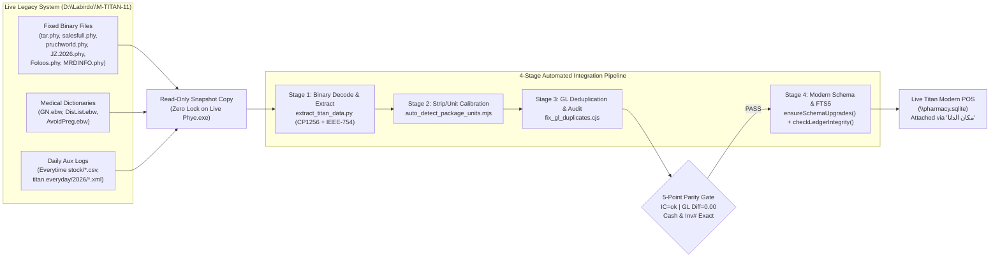
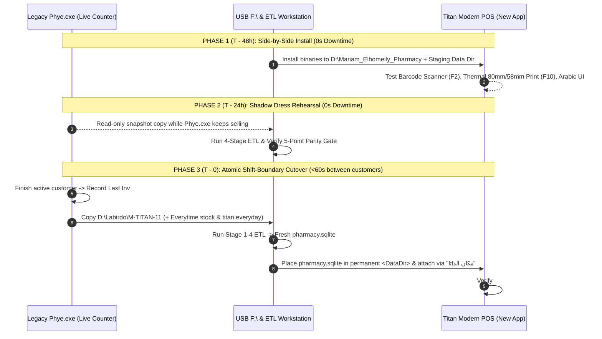

# Legacy Integration & Zero-Downtime Cutover Plan
**System:** Titan Modern POS (`Mariam Elhomeily Pharmacy`)  
**Source Legacy System:** Titan 3 / M-TITAN-11 (`Phye.exe`, Visual Basic 6)  
**Authoritative Storage Engine:** SQLite (`pharmacy.sqlite`, WAL Mode + FTS5 Unicode61)

---

## 1. Executive Summary & System Landscape

This document defines the complete engineering integration strategy and operational cutover runbook for migrating a **live, operating pharmacy** from the legacy **Titan 3 VB6 (`Phye.exe`)** application to **Titan Modern POS (`Mariam Elhomeily Pharmacy.exe`)** with **zero customer-facing downtime**, **zero data loss**, and **instant rollback capability**.

### 1.1 Environment Matrix

| Attribute | Live Legacy System (Source) | Titan Modern POS (Target) |
|---|---|---|
| **Application** | Titan 3 / `M-TITAN-11` (`Phye.exe`, `emerg.w.exe`) | `Mariam Elhomeily Pharmacy.exe` (Electron 40 + React 19) |
| **Runtime Path on Pharmacy PC** | `D:\Labirdo\M-TITAN-11` (configured via `Titan.path`) | Isolated folder, e.g., `D:\Mariam_Elhomeily_Pharmacy\` |
| **Auxiliary Live Folders** | `Everytime stock\<YYMMDD>\*.csv`, `titan.everyday\2026\*.xml` | `<ChosenDataDir>\backups\` + USB `titan_backups\` |
| **Storage Technology** | Fixed-width binary `.phy` / `.ebw` + CP1256 `.txt` | `better-sqlite3` (`pharmacy.sqlite`, `WAL` + `FTS5`) |
| **User-Selectable Data Dir** | Hardcoded in `Titan.path` | Configurable in installer wizard or in-app **`مكان الداتا`** (`storage-config.json`) |
| **Windows Dependencies** | VB6 runtime, `msflxgrd.ocx`, `XI.dll`, `zlibwapi.dll` | 100% self-contained (offline bundled fonts & native ABI 143 bindings) |

### 1.2 Why Zero-Conflict Side-by-Side Coexistence Works

Both systems can safely live on the same Pharmacy PC simultaneously without interfering with each other:
1. **Zero Shared Files or Locks:** `Phye.exe` reads/writes binary `.phy` files inside `D:\Labirdo\M-TITAN-11\Files\DBI\`. Titan Modern POS reads/writes only its isolated `<ChosenDataDir>\pharmacy.sqlite`.
2. **Zero Shared Registry or Port Conflicts:** Titan Modern POS uses Electron's local `app.getPath('userData')` (`%APPDATA%\Mariam Elhomeily Pharmacy\`) and opens no network sockets in production.
3. **Read-Only Legacy Access:** All ETL extraction scripts open legacy `.phy`/`.ebw`/`.csv`/`.xml` files strictly in **Read-Only** mode from a snapshot copy—never writing a single byte back into `D:\Labirdo\M-TITAN-11`.

### 1.3 Closing the "Stale Snapshot Gap" (`2026-10-14` Baseline vs. Live `T-0`)

The clean baseline database currently packaged in `data/pharmacy.sqlite` was extracted from the `2026-10-14` snapshot (`18,574` items, max sales invoice `#864`, max purchase invoice `#311`, treasury cash `119,242.50 EGP`, balanced GL `402,502.50 EGP`).

Because the legacy system `Phye.exe` has continued processing live counter sales, stock deductions, supplier purchases, and price updates since `2026-10-14`, **you MUST NOT go live on the stale baseline snapshot**. At cutover (`T-0`), you must run a fresh delta-free snapshot extraction from the live `D:\Labirdo\M-TITAN-11` files so Titan Modern POS begins at `#N + 1` with exact live stock, live cash drawer balance, and balanced double-entry accounting.

---

## 2. Data Integration Architecture (`.phy` / `.ebw` -> `pharmacy.sqlite`)



### 2.1 Complete 22-Table Legacy-to-SQLite Mapping

| # | Legacy File(s) & Format | Target SQLite Table | Extraction & Encoding Details |
|---|---|---|---|
| 1 | `Files\DBI\tar.phy` (856 B fixed records) | `items` | Decodes CP1256 names/producer/generic/category + IEEE-754 barcode (`130..137`), stock (`176..179`), strip units (`196..197`), consumer/previous/buy prices (`208`, `224`, `244`), discount (`238`, `786`), tax schedule (`788`) |
| 2 | `Files\DBI\salesfull.phy` (997 B records, 50,000 slots) | `sales_invoices` | Non-empty active invoices `#1..#N`; Titan Modern POS automatically starts next invoice at `MAX(invoice_number) + 1` |
| 3 | `Files\DBI\salesfull.phy` (embedded line arrays) | `sales_invoice_items` | Line items, sold quantities, unit prices, discounts, costs, timestamps |
| 4 | `Files\DBI\pruchworld.phy` (5,000 pre-allocated slots) | `purchases_invoices` | Supplier purchase headers with invoice IDs and net totals |
| 5 | `Files\DBI\pruchworld.phy` (item arrays) | `purchase_invoice_items` | Quantities, bonus units, consumer/buy prices, line totals |
| 6 | `Files\DBI\MRDINFO.phy` (128 B supplier blocks) | `suppliers` | Full supplier directory and contact phones |
| 7 | Structured empty container | `supplier_transactions` | Ready for Modern POS purchase and cash supplier payment ledger entries |
| 8 | `Files\DBI\customers.w.phy` | `customers` | Customer directory and outstanding credit (`account_balance`) |
| 9 | `Files\DBI\ShogUser.phy` | `users` | Staff accounts & permission masks (auto-ensures `د. مريم الحميلي` on startup) |
| 10 | `Files\DBI\delhis.phy` | `delivery_orders` | Historical delivery dispatches and statuses |
| 11 | `Files\DBI\Dailymax.phy`, `daily-manual-2.phy` | `daily_financial_summary` | Historical daily drawer summaries |
| 12 | `Files\DBI\MRDINFO.phy` (return stream) | `undo_sales_history` | Historical voided/returned line log |
| 13 | `Files\DB\GN.ebw` (128 B length-prefixed CP1256) | `medical_generic_dictionary` | Canonical active ingredient dictionary (`1,857+` generics) |
| 14 | `Files\DB\DisList.ebw` (128 B length-prefixed) | `medical_disease_interactions` | Disease & trimester contraindication tags |
| 15 | `Files\DB\AvoidPreg.ebw` (64x Int16 matrix) | `medical_pregnancy_warnings` | Relational drug-to-pregnancy interaction rules for POS safety alerts |
| 16 | `Files\DB\Nilsenlist.rar` (plain text) | `contact_phone_numbers` | Saved representative & client phone directory |
| 17 | `Files\DBI\lastoot.txt` | `shortages_drafts` | Active pharmacy shortage orders mapped to `item_id` & supplier |
| 18 | `Files\DBI\Price-log.txt` | `price_change_history` | Chronological pharmaceutical price revision log |
| 19 | `Files\DBI\JZ.2026.phy` (328 B records, VB6 Date) | `general_ledger_2026` | Balanced 2026 double-entry journal (`Cash`, `COGS`, `Revenue`, `Inventory`, `Suppliers`) |
| 20 | `Files\DBI\Foloos.phy` (IEEE-754 Double @ offset `8`) | `treasury_state` | Live opening treasury cash balance (`id = 1`) |
| 21 | `Files\DBI\workperiod.phy` | `work_shifts` | Schema initialized ready for Shift Management (`F5`) |
| 22 | `Files\DBI\CustHis2.phy` (2,010 B blocks) | `customer_transactions` | Customer settlement checkpoints |

**Auxiliary Live Enrichment:**
- `Everytime stock\<YYMMDD>\*.csv`: Cross-checks latest closing stock and expiration dates (`MM-YYYY`).
- `titan.everyday\2026\*.xml`: Recovers scanned barcodes absent from `tar.phy` primary records.

**Modern POS Runtime Tables & Upgrades (`ensureSchemaUpgrades()` in `src/main/db.ts`):**
Upon opening the migrated SQLite file, Titan Modern POS automatically creates any missing audit tables and indexes without altering legacy rows:
- `sales_returns` (per-line return tracking preventing duplicate refunds & over-returns)
- `inventory_adjustments_log` (manual stock & expiry edit audit trail)
- `customer_ledger` (credit sale & payment audit history)
- `items_fts` (SQLite `FTS5` virtual table with `unicode61 remove_diacritics 2` for sub-millisecond search)
- Unique double-entry constraint `idx_gl_unique_doc_account` on `general_ledger_2026 (document_ref, account_name)`

### 2.2 Detailed Byte Layout of `tar.phy` (856-Byte Record Structure)

The extraction script decodes `tar.phy` deterministically using the following verified offsets:
- `0x000–0x027` (`40 B`, CP1256): `item_name_en`
- `0x028–0x045` (`30 B`, CP1256): `item_name_ar`
- `0x046–0x059` (`20 B`, CP1256): `producer`
- `0x05A–0x081` (`40 B`, CP1256): `generic_name`
- `0x082–0x089` (`8 B`, `<d` IEEE-754 Double): `barcode`
- `0x0B0–0x0B3` (`4 B`, `<f` IEEE-754 Float): `current_stock`
- `0x0C4–0x0C5` (`2 B`, `<h` Int16 @ offset `196`): `package_units` (strip/sachet/ampoule count per pack)
- `0x0D0–0x0D3` (`4 B`, `<f` Float): `consumer_price`
- `0x0E0–0x0E3` (`4 B`, `<f` Float): `previous_price`
- `0x0EE–0x0EF` (`2 B`, `<h` Int16): `discount_pct`
- `0x0F4–0x0F7` (`4 B`, `<f` Float): `buy_price`
- `0x30C–0x30D` (`2 B`, `0xFFFF`): VB6 end-of-struct sentinel (`-1`)
- `0x312–0x313` (`2 B`, `<h` Int16 @ offset `786`): `pharmacy_discount_percent` (`25%` local drugs, `5%` infant milk, `30%` cosmetics, `8%` special schedule)
- `0x314–0x315` (`2 B`, `<h` Int16 @ offset `788`): `tax_schedule_category` (controlled schedule classes `1` & `2`)
- `0x31C–0x34D` (`50 B`, CP1256 @ offset `796`): `category`

### 2.3 Exact 4-Stage ETL Command Pipeline

All scripts currently read from `D:\pharmacy\old_sys\` (`TAR_PATH` / `BASE_DIR`). Before running on a fresh cutover snapshot, back up the prior `D:\pharmacy\old_sys` folder (if needed) and copy the fresh `T-0` legacy snapshot into `D:\pharmacy\old_sys\` so `Files\DBI`, `Files\DB`, `Everytime stock`, and `titan.everyday` are in place.

```powershell
# Stage 1: Extract binary .phy/.ebw + XML/CSV logs into clean SQLite (Read-Only on old_sys)
python D:\pharmacy\clean_data\scripts\extract_titan_data.py

# Stage 1b: Copy extracted SQLite into Modern POS staging workspace
Copy-Item -Path "D:\pharmacy\clean_data\titan_extracted.sqlite" `
          -Destination "D:\pharmacy\titan_modern_pos\data\pharmacy.sqlite" -Force

# Stage 2: Calibrate strip/unit counts (package_units) from tar.phy offset 196 & historical fractions
Set-Location "D:\pharmacy\titan_modern_pos"
node scripts\auto_detect_package_units.mjs

# Stage 3: Deduplicate any legacy duplicate GL rows BEFORE Modern POS enforces unique GL index
node scripts\fix_gl_duplicates.cjs

# Stage 4: Run Modern POS upgrade/integrity pass & verify FTS5 + WAL + GL balance
npx tsx -e "import { initDatabase, checkLedgerIntegrity, closeDatabase } from './src/main/db'; initDatabase(); const gl = checkLedgerIntegrity(); console.log(gl); closeDatabase(); if (!gl.balanced) process.exit(1);"
```

> **CRITICAL ORDERING RULE:** Stage 3 (`fix_gl_duplicates.cjs`) **MUST** run *before* Stage 4 / first app launch on a newly extracted legacy SQLite file, because `ensureSchemaUpgrades()` creates `UNIQUE INDEX idx_gl_unique_doc_account ON general_ledger_2026 (document_ref, account_name)`. Running `fix_gl_duplicates.cjs` first prevents silent index creation failure on legacy duplicate postings and guarantees an exact `0.00 EGP` GL balance.

---

## 3. Zero-Downtime Cutover Execution Plan

### 3.1 Architecture of Zero-Downtime Cutover



---

### Phase 1: Pre-Cutover Side-by-Side Staging & Hardware Verification (`T - 48h` to `T - 24h`)
**Downtime:** `0 seconds` (Legacy `Phye.exe` remains open and serving customers normally).

1. Plug USB drive `F:\` into the Pharmacy PC.
2. Run **`تثبيت_سريع_على_كمبيوتر_الصيدلية.bat`** (`F:\install_wizard.ps1`).
   - Install program binaries to `D:\Mariam_Elhomeily_Pharmacy` (or `C:\` if no `D:` fixed disk exists).
   - For staging rehearsal, choose a staging data folder such as `D:\Mariam_Elhomeily_Staging_Data`.
3. Launch Titan Modern POS from the newly created Desktop shortcut **`صيدلية د. مريم الحميلي`**.
4. Perform **non-intrusive hardware validation** on the actual pharmacy counter machine:
   - Scan a drug box with the **USB barcode scanner** inside the POS search bar (`F2`): verify instant item lookup + beep + cursor readiness.
   - Verify **Thermal Printer (`80mm` or `58mm`)**: open a test preview or historical invoice, press **`F10`** / Print to verify paper width alignment, crisp Arabic Cairo font, and zero clipping (`@media print` rules). (Use a scratch folder or revert/discard any test invoice in staging; never carry staging invoices into `T-0` production DB).
   - Brief counter pharmacists on core hotkeys:
     - `F1`: POS | `F2`: Focus Search | `F3`: Purchases | `F4`: Shortages
     - `F5`: Treasury & Shifts | `F6`: Financial Reports | `F7`: Catalog & Stock
     - `F8`: Hold / New Tab | `F9`: Save | `F10`: Save & Print | `F11`: Quick Return

---

### Phase 2: Shadow Dress Rehearsal & Parity Audit (`T - 24h`)
**Downtime:** `0 seconds`.

1. Without closing `Phye.exe`, take a read-only copy of `D:\Labirdo\M-TITAN-11`, `Everytime stock`, and `titan.everyday` (or schedule between customers).
2. Run the 4-stage ETL pipeline (Section 2.3) end-to-end.
3. Time the entire run to establish baseline duration (~30–45 seconds once files are copied).
4. Compare **10 random items** (stock + consumer price + expiry), **latest invoice number `#N`**, **latest purchase invoice**, and **`Foloos.phy` cash balance** between `Phye.exe` and Titan Modern POS (`pharmacy.sqlite`). Resolve any custom local quirks before shift cutover.

---

### Phase 3: Atomic Shift-Boundary Cutover (`T - 0`)
**Target Window:** Natural quiet shift handover (e.g. afternoon/night shift transition when no customer is waiting at the register).  
**Anti-Split-Brain Golden Rule:** Once the `T-0` snapshot begins, **never create another invoice in `Phye.exe`**. There must only ever be **one active writer**.

#### Choose Workflow A or B based on Pharmacy PC tooling:

##### Workflow A — USB Shuttle Cutover (Pharmacy PC has NO Python / Node installed)
1. **Freeze Legacy Writer (`~15 sec`):**
   - Finish serving the current customer in `Phye.exe`.
   - Record on paper: **Last Sales Invoice `#N`**, **Physical Drawer Cash (`X EGP`)**, and **`Phye.exe` Cash Balance**.
   - Close `Phye.exe`.
   - Rename the legacy Desktop shortcut to `Archive - Old Titan (DO NOT USE FOR SALES)`.
2. **Copy Live Snapshot to USB (`~15 sec`):**
   - Copy `D:\Labirdo\M-TITAN-11` (and `Everytime stock` / `titan.everyday` if present on `D:\`) to `F:\live_cutover_snapshot\`.
3. **Run 4-Stage ETL on Developer Laptop (`~1–2 min`):**
   - Copy `F:\live_cutover_snapshot\` into `D:\pharmacy\old_sys\` (backing up previous `old_sys` first).
   - Run **Stages 1 -> 2 -> 3 -> 4** from Section 2.3.
   - Verify the **5-Point Go-Live Gate** (Section 4) passes with `0.00` GL imbalance.
   - Copy the freshly minted `D:\pharmacy\titan_modern_pos\data\pharmacy.sqlite` (`~14 MB`) to `F:\fresh_production_db\pharmacy.sqlite`.
4. **Attach Live DB on Pharmacy PC (`~20 sec`):**
   - Copy `F:\fresh_production_db\pharmacy.sqlite` into the Pharmacy PC's permanent protected data folder, e.g.:  
     `D:\Mariam_Elhomeily_Pharmacy_Data\pharmacy.sqlite`
   - Open Titan Modern POS (`صيدلية د. مريم الحميلي`).
   - Click **`مكان الداتا`** in the top header -> **`اختيار / تغيير مجلد حفظ الداتا...`** -> select `D:\Mariam_Elhomeily_Pharmacy_Data` -> choose **"فتح واستخدام قاعدة البيانات الموجودة في هذا المجلد"**.
5. **Handling Walk-In Customers During the 2–3 Minute Shuttle (Zero Customer Wait):**
   - If an urgent customer walks in during Steps 2–4, **do NOT reopen `Phye.exe`** (reopening creates split-brain). Dispense the medication immediately and jot barcode + qty + cash on a **Cutover Tally Sheet**. The second Titan Modern POS comes up in Step 4, scan those items as Invoice `#N + 1` in <10 seconds. Customer service never stops.

##### Workflow B — Direct On-PC Cutover (If Python 3 + Node.js are installed on Pharmacy PC)
1. Finish active customer -> record `#N` and cash balance -> close `Phye.exe` -> rename legacy shortcut.
2. Snapshot `D:\Labirdo\M-TITAN-11` into staging, execute Stages 1–4 directly on the Pharmacy PC (`~35–45 seconds`).
3. Move the verified `pharmacy.sqlite` into `D:\Mariam_Elhomeily_Pharmacy_Data\pharmacy.sqlite` and attach via **`مكان الداتا`** (or overwrite when app is closed).
4. Reopen Titan Modern POS, verify Header stats, open **Shift #1 (`F5`)** with physical opening cash count, and ring up Invoice `#N + 1`. **Total counter transition: < 60 seconds.**

---

## 4. Mandatory 5-Point Go-Live Verification Gate

Before issuing live Invoice `#N + 1` to the first patient, verify every check passes:

| # | Check Item | How to Verify | Required Pass Criteria |
|---|---|---|---|
| 1 | **SQLite File Integrity** | `PRAGMA integrity_check` or clean app boot without error dialog | Returns `ok`; app opens POS (`F1`) smoothly |
| 2 | **Double-Entry GL Balance** | Startup console / notification (`checkLedgerIntegrity()`) & Reports (`F6`) | `SUM(debit) == SUM(credit)` (`diff <= 0.05 EGP`, zero imbalance warning) |
| 3 | **Cash Drawer Continuity** | Header **`الخزينة`** badge vs. `Phye.exe` closing cash | Matches closing `Foloos.phy` to the piaster |
| 4 | **Invoice Number Continuity** | Header **`فاتورة: #N`** badge vs. `Phye.exe` last closed invoice | Displays `#N`; test-read confirms next invoice will be `#N + 1` |
| 5 | **Stock & Strip Calibration** | Spot check 5 solid box+strip drugs & 3 syrups/creams in `F1` / `F7` | Solid drugs have accurate `package_units` (`>1`), syrups/creams remain `1`, stock & prices match live shelf |

---

## 5. Post-Cutover Hypercare (Days 1–14) & Instant Rollback

### 5.1 Daily Hypercare Protocol
- **Keep Legacy Frozen Archive (`30 Days`):** Never delete `D:\Labirdo\M-TITAN-11`. Keep it read-only on disk for at least 30 days as historical reference.
- **Strict Shift Handovers (`F5`):** Have cashiers open shifts (`فتح وردية`) with exact starting drawer float and close shifts (`إغلاق ومطابقة الوردية`) at every shift boundary—comparing `expected_cash` against physical drawer count (`discrepancy`).
- **End-of-Day Dual Backup (`نسخ احتياطي`):** Plug USB flash drive in for 5 seconds at closing and click **`نسخ احتياطي`** in the header. SQLite's non-blocking Online Backup API writes both `<ChosenDataDir>\backups\pharmacy_backup_<timestamp>.sqlite` and `F:\titan_backups\...` without slowing or interrupting open tabs.
- **Weekly Reports Audit (`F6`):** Verify Financial P&L (`getFinancialReport`) and General Ledger balance after the first week of live returns, purchases, credit sales, and expenses.

### 5.2 Emergency Instant Rollback (`< 60 Seconds`, Zero Data Loss)

Because `D:\Labirdo\M-TITAN-11` is **never modified** during migration or modern POS operation, rolling back in a worst-case hardware/printer/OS emergency is clean and deterministic:
1. Open **`التقارير (F6)`** or Recent Sales Invoices in Titan Modern POS and export/print every invoice issued since cutover (`#N + 1` through `#K`), plus any purchase invoices or treasury expenses entered after cutover.
2. Close **Titan Modern POS** completely (clean shutdown automatically checkpoints SQLite WAL).
3. Restore the legacy Desktop shortcut to `D:\Labirdo\M-TITAN-11\Phye.exe`.
4. Key in only the delta transactions (`#N + 1..#K`) into `Phye.exe` so legacy stock and cash remain 100% continuous.
5. Diagnose the issue on the frozen `<ChosenDataDir>\pharmacy.sqlite` snapshot offline without affecting counter operations.
